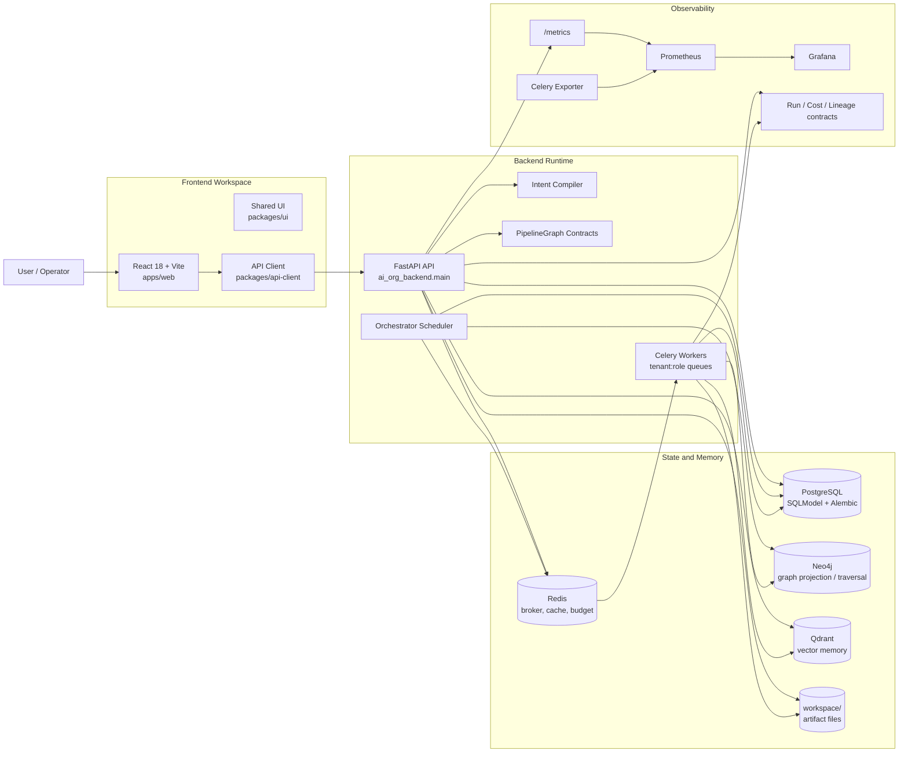
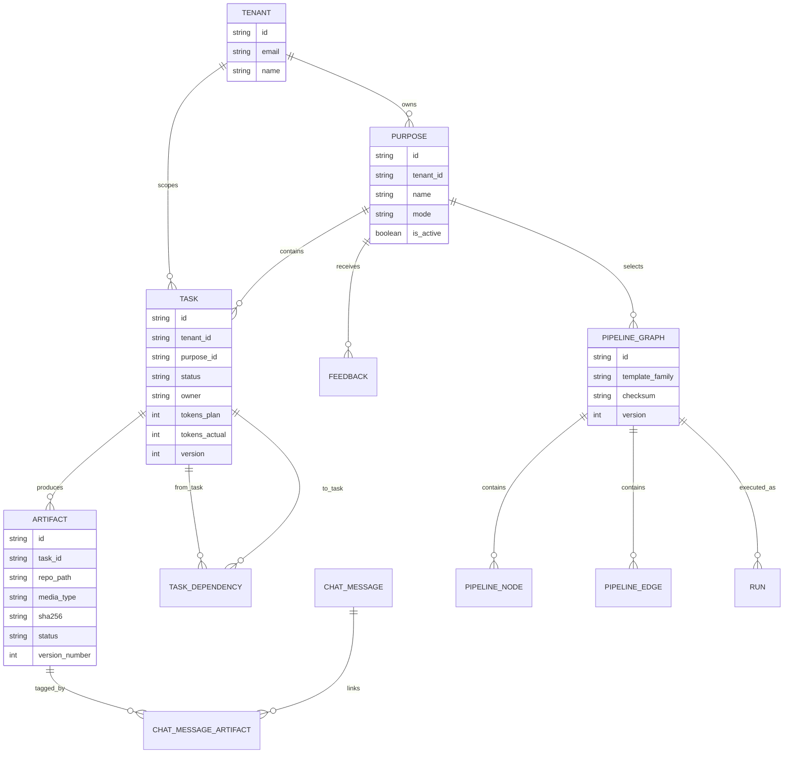
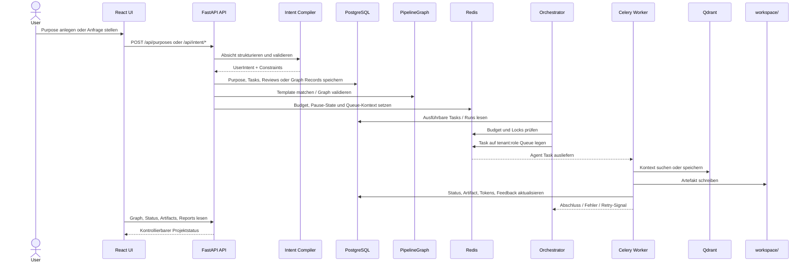
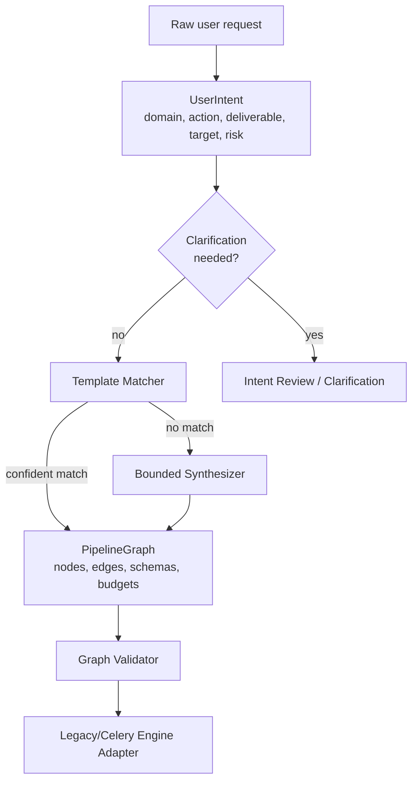

# AI-Org Prototype Architecture

## Zweck dieses Dokuments

Dieses Dokument ist der technische Einstiegspunkt für die Root-Ebene des Repositories. Es fasst die aktuelle Architektur, Laufzeitkomponenten, Datenflüsse und wichtigsten Grenzen zusammen. Detail-ADRs und Phasendokumente liegen ergänzend unter `docs/architecture/`.

AI-Org ist ein Monorepo mit einem FastAPI/Celery-Backend, einem React/Vite-Frontend, relationalen und graphbasierten Datenmodellen, Vektorspeicher, Queueing, Monitoring und Docker-Compose-Betrieb.

## Architektur auf einen Blick



## Systemgrenzen

| Bereich | Verantwortung | Code |
| --- | --- | --- |
| API | Auth, Purpose-, Task-, Artifact-, Graph-, Chat-, Template- und Settings-Endpunkte | `backend/ai_org_backend/api/`, `backend/ai_org_backend/main.py` |
| Orchestrierung | Scheduling, Task-Inspection, Routing, Watchdog, Locks und Ausführung | `backend/ai_org_backend/orchestrator/` |
| Agenten | Rollenbasierte Arbeitseinheiten für PRD, Architektur, Planung, Dev, QA, Reviews usw. | `backend/ai_org_backend/agents/` |
| Graph Contracts | PipelineGraph-v2, Validierung, Templates, Synthese, Workflow Search | `backend/ai_org_backend/graph/` |
| Intent | Kompilierung und Validierung von Nutzerabsichten | `backend/ai_org_backend/intent/` |
| Persistenz | SQLModel-Modelle, Alembic-Migrationen, Repo-Helper, Storage | `backend/ai_org_backend/models/`, `backend/ai_org_backend/alembic/`, `backend/ai_org_backend/services/` |
| Frontend | Login, Dashboard, Pipeline, Graph, Reports, Templates, Chat | `frontend/apps/web/` |
| Ops | Docker Compose, Prometheus, Grafana, persistent volumes | `ops/`, `docker-compose.yml` |

## Laufzeitkomponenten

| Komponente | Rolle | Standard-Port |
| --- | --- | --- |
| FastAPI `ai-app` | REST API, WebSockets, Metrics, Runtime-Koordination | `8000` |
| Celery Worker | Agentenarbeit auf tenant-spezifischen Queues | intern |
| Orchestrator | Scheduler und Graph-/Task-Ausführung | intern |
| PostgreSQL | Autoritative relationale Daten: Tenants, Purposes, Tasks, Artifacts, Graph Records | `5432` |
| Redis | Celery Broker, Result Backend, Budget-/Pause-/Runtime-Cache | `6379` |
| Neo4j | Graph-Projektion und Traversal für Dependencies/Lineage | `7687`, UI `7474` |
| Qdrant | Semantischer Kontext und Vektorspeicher | `6333` |
| React/Vite | Admin- und Pipeline-Oberfläche | `5173` dev, Nginx im Container |
| Prometheus | Metriken-Scraping | `9090` |
| Grafana | Dashboards | `3000` |

## Kern-Domänenmodell



PostgreSQL ist die autoritative Persistenz für Geschäftsobjekte und Graph-v2-Records. Neo4j dient als graphoptimierte Projektion für Abhängigkeiten, Traversal und Scheduling-Sichten. Direkte, manuelle Neo4j-Mutation ist nicht das primäre Schreibmodell; Änderungen laufen über Backend-Services, Sync/Reconciliation und SQLModel-nahe Verträge.

## Request- und Ausführungsfluss



## Backend

### FastAPI

`backend/ai_org_backend/main.py` ist der API-Einstiegspunkt. Die App installiert:

- Request IDs,
- Security Headers,
- HTTP Metrics,
- Rate Limiting,
- Input Sanitization,
- CORS,
- globale Exception Handler,
- Health- und Readiness-Probes,
- `/metrics` via Prometheus ASGI App.

Wichtige Router:

- `auth`: Registrierung und Login,
- `pipeline`: Purposes, Backlog, Graph, Artifacts, Pause/Resume, Pipeline-Konfiguration,
- `intent`: Compile, Validate, Intent Review,
- `chat`: Chat, WebSocket, Artifact-Tags,
- `artifact_bridge`: Artifact-Metadaten und feedbacknahe Zugriffspfade,
- `purposes`: Purpose Lifecycle,
- `settings`: Theme und Research-Settings,
- `templates`: Template Studio.

### Celery

`backend/ai_org_backend/tasks/celery_app.py` definiert Broker, Backend, Routing, Timeouts, Budget-Gate und Lifecycle-Signale.

Wichtige Eigenschaften:

- Redis ist Broker und Result Backend.
- Tasks werden dynamisch auf `tenant_id:role` Queues geroutet.
- Vor dem Publish wird Budget geprüft.
- Beim Start einer Task wird Status `doing`, Version und Heartbeat gesetzt.
- Fehler schreiben `failed` oder verschieben nach Retry-Erschöpfung in DLQ-/Watchdog-Flows.
- Terminale Tasks werden gegen doppelte Ausführung geschützt.

### Orchestrator

Der Orchestrator ist die Scheduling-Schicht. Er liest Graph-/Task-Zustand, prüft Abhängigkeiten, Budget und Locks, aktualisiert Status und dispatcht Arbeit an Celery. Er ist bewusst getrennt von der HTTP-Schicht, damit API-Zugriffe, Scheduler und Worker unabhängig skalierbar bleiben.

### Agenten

Agenten sind Celery Tasks mit rollenbezogener Verantwortung. Beispiele:

- `agent.po`: PRD und Produktanforderungen,
- `agent.architect`: Architektur-Blueprint,
- `agent.planner`: Entwicklungsplan und Tasks,
- `agent.dev`: Implementierungsartefakte,
- `agent.qa`, `agent.integration`, `agent.security`, `agent.performance`: Qualitätssicherung,
- `agent.reviewer`: Review-Artefakte,
- `agent.vision`: Vision-Dokumente,
- `graph.sync` und `graph.reconcile`: Graph-Synchronisation.

## Intent, Graph und Templates

AI-Org trennt Nutzerabsicht, Workflow-Vertrag und Runtime-Ausführung.



Der aktuelle Stand ist additiv:

- Legacy-Pipeline und bestehende Celery Tasks bleiben ausführbar.
- PipelineGraph-v2 definiert den Zielvertrag für neue Workflows.
- Template-Familien liegen unter `backend/ai_org_backend/graph/templates/*.yaml`.
- Capability-Kataloge liegen unter `backend/ai_org_backend/graph/capability_catalog/*.yaml`.
- Validierung verhindert tote Knoten, inkompatible Datenkanten, ungebundene Zyklen und High-Risk-Ausführung ohne Approval.

## Frontend

Das Frontend ist ein pnpm-Workspace unter `frontend/`.

| Package | Aufgabe |
| --- | --- |
| `apps/web` | React-App mit Routen für Login, Dashboard, Pipeline, Graph, Templates, Reports, Insights und Profil |
| `packages/ui` | Gemeinsame UI-Komponenten |
| `packages/api-client` | Fetch-/API-Helfer und Auth-Header-Handling |

Die App nutzt:

- React 18,
- Vite 5,
- Tailwind,
- React Router,
- Zustand,
- React Flow,
- Mermaid-Rendering für Markdown,
- Monaco Editor für Template-/Textarbeit.

Private Routen prüfen den JWT aus `localStorage`. API-Aufrufe laufen in der Entwicklung über den Vite-Proxy auf `/api`; im Containerbetrieb übernimmt Nginx/Compose die Kopplung.

## Datenhaltung und Artefakte

### PostgreSQL

PostgreSQL hält die transaktionale Wahrheit:

- Tenants und Auth-Kontext,
- Purposes,
- Tasks und Dependencies,
- Artifacts,
- Feedback und Chat Messages,
- Pipeline Templates und Phase-Konfiguration,
- PipelineGraph-v2 Records,
- Runs,
- Audit-/Review-/Statusdaten.

Migrationen liegen unter `backend/ai_org_backend/alembic/versions/`.

### Neo4j

Neo4j optimiert Graphabfragen. Es spiegelt Task- und Artifact-Beziehungen für Traversal, Statussicht, Scheduling und Reconciliation. Die Datenquelle für fachliche Persistenz bleibt PostgreSQL.

### Qdrant

Qdrant speichert semantische Vektoren für Kontextsuche, Memory und relevante Snippets. Services wie `vector_store.py`, `memory.py` und kontextnahe Agenten verwenden diese Schicht.

### Redis

Redis ist:

- Celery Broker,
- Celery Result Backend,
- Budget-/Pause-/Runtime-Cache,
- Heartbeat- und Watchdog-Hilfsspeicher.

### workspace/

Dateibasierte Artefakte werden unter `workspace/` abgelegt und in PostgreSQL mit Pfad, MIME-Type, Größe, SHA-256, Version und Status referenziert.

## Rework, Review und Invalidation

Rework ist kein freier Loop. Die Architektur verlangt begrenzte Revisionen:

- `max_revisions`,
- `cost_budget`,
- `convergence_predicate`.

Artefakte können `fresh`, `stale`, `invalidated` oder `archived` sein. Downstream-Invalidation soll dafür sorgen, dass Änderungen nicht nur lokal gespeichert werden, sondern betroffene Folgeartefakte sichtbar veraltet werden.

## Observability

Die Observability-Schicht umfasst zwei Ebenen:

1. **Betrieb:** Prometheus-Metriken aus FastAPI und Celery Exporter, Grafana-Dashboards, Health-/Readiness-Probes.
2. **Ausführung:** Run-Traces, Cost Records und OpenLineage-artige Events als adapterfähige Verträge unter `backend/ai_org_backend/observability/`.

Ziel ist, KI-Arbeit wie einen Produktionsprozess zu betreiben: Status, Kosten, Fehler, Durchlaufzeit und Lineage müssen sichtbar sein.

## Security und Governance

Aktuelle Schutzschichten:

- JWT-basierte Authentifizierung,
- Tenant-Scoping über API-Dependencies und Modelle,
- Rate Limiting,
- Security Headers,
- Input Sanitization,
- CORS-Konfiguration,
- Budget-Gates vor Task-Publish,
- Approval Gates für risikoreiche Graph-Knoten,
- Audit- und Review-Modelle.

Für produktiven Mehrmandantenbetrieb bleiben Secrets Management, Rollen-/Rechtekonzept, Datenisolation, Backups, Audit-Export und Policy Enforcement explizite Ausbaupunkte.

## Deployment und lokale Entwicklung

### Docker Compose

Der persistente lokale Stack liegt in `ops/persistent.yml`:

```bash
docker compose --env-file .env -f ops/persistent.yml up -d
```

Optionale Profile und Overlays können Frontend oder Monitoring aktivieren. Ports können lokal durch zusätzliche Compose-Override-Dateien angepasst werden, wenn Standardports belegt sind.

### Lokales Backend

```bash
pip install -e backend/.[dev]
uvicorn ai_org_backend.main:app --reload --port 9102
```

### Lokales Frontend

```bash
cd frontend
corepack pnpm install
corepack pnpm dev
```

Das Frontend erwartet in der Entwicklung standardmäßig einen `/api`-Proxy zum Backend.

## Quality Gates

| Gate | Befehl |
| --- | --- |
| Backend Lint | `make lint` |
| Backend Types | `make typecheck` |
| Backend Tests | `make test` |
| Fünf-Schichten-Test-Harness | `make test-all` |
| Architektur-Audit | `make audit` |
| Graph-/Template-Validierung | `make graph-validate` |
| Frontend Build | `cd frontend && corepack pnpm --filter web build` |

CI-Workflows liegen unter `.github/workflows/` und nutzen Node 20 mit pnpm `10.13.1` für den Frontend-Workspace.

## Architekturprinzipien

1. **Postgres für Wahrheit, Graph für Struktur**
   Fachliche Zustände sind relational nachvollziehbar. Graphprojektionen dienen Traversal, Planung und Visualisierung.

2. **Runtime ist asynchron**
   LLM- und Agentenarbeit läuft nicht im Request-Thread, sondern über Queues, Worker, Heartbeats und Statusupdates.

3. **Graph Contracts sind stabiler als Rollennamen**
   Rollen bleiben wichtig, aber die langfristige Workflow-Semantik liegt in typisierten Knoten, Kanten und Capabilities.

4. **Jede Autonomie braucht Grenzen**
   Budget, Timeout, Retry, Approval, Revision Limits und Validation sind Teil des Ausführungsvertrags.

5. **Artefakte sind prüfbare Outputs**
   Antworten ohne persistierten Output gelten nicht als belastbare Lieferung.

6. **Beobachtbarkeit ist kein Add-on**
   Health, Metrics, Cost, Lineage und Audit müssen mitwachsen, wenn Agenten autonomer werden.

## Bekannte Grenzen

- PipelineGraph-v2 ist als Contract Layer vorhanden, aber Legacy-Tasks und Adapter sind weiterhin Teil der Runtime.
- Einige Rework- und Review-Flows sind historisch gewachsen und werden schrittweise in zentrale Services konsolidiert.
- Neo4j-Sync und Reconciliation sind operativ wichtig, aber nicht die alleinige Quelle der fachlichen Wahrheit.
- Produktionsreife Mandantenisolation, RBAC, Secrets und Billing sind noch Ausbaupunkte.
- Externe LLM-Provider und Research-Integrationen brauchen konsequente URL-, Kosten- und Datenkontrollen.

## Weiterführende Dokumente

- `VISION.md` - Produktvision und Leitprinzipien.
- `README.md` - Setup, Features und API-Überblick.
- `README_local__setup.md` - lokales Docker-Setup.
- `READMEpipeline.md` - Pipeline- und Agentenabläufe.
- `docs/architecture/00-glossary.md` - Begriffe.
- `docs/architecture/01-intent-compiler.md` - Intent-Compiler.
- `docs/architecture/02-pipeline-graph.md` - PipelineGraph-v2.
- `docs/architecture/03-templates.md` - Template-Familien.
- `docs/architecture/04-rework-invalidation.md` - Rework und Invalidation.
- `docs/architecture/05-observability.md` - Tracing, Cost und Lineage.
- `docs/architecture/06-test-harness.md` - Test-Harness.
