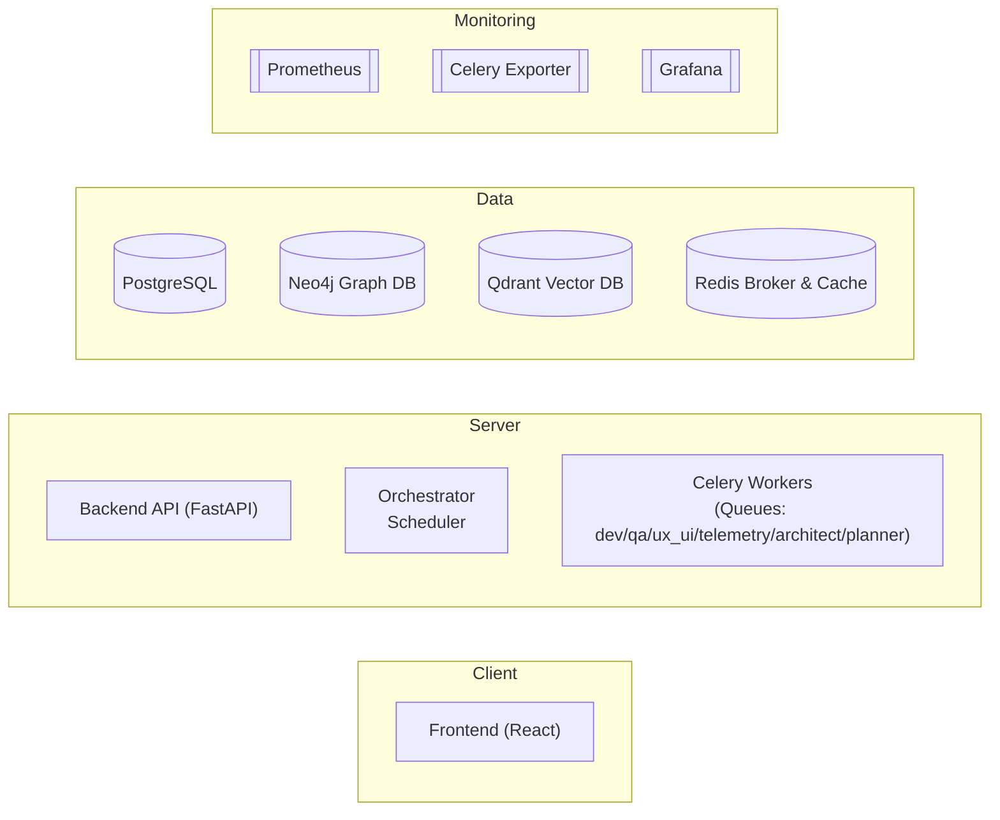
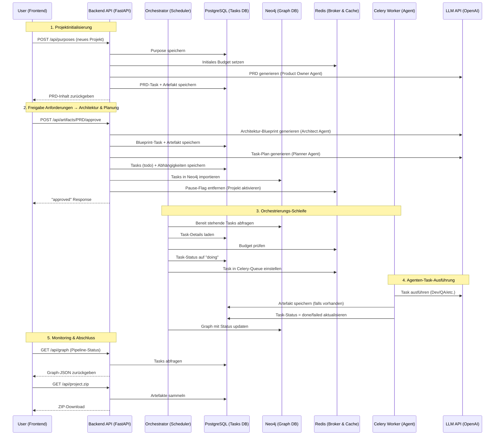
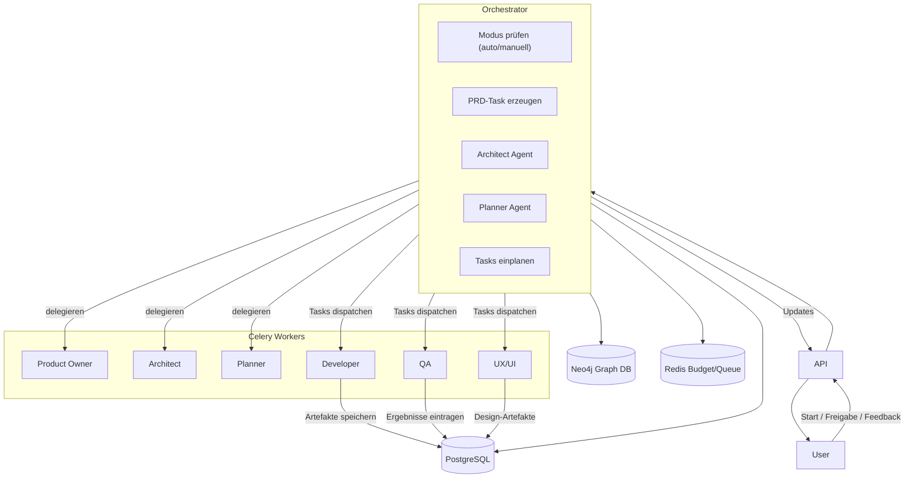

# AI‑Org Prototype **2.0**
Autonomous‑Agent SaaS • Neo4j‑driven • Multi‑Tenant • Token‑Aware • Prometheus‑Instrumented

> End‑to‑End Skeleton, das ganze Software‑Projekte mittels LLM‑Agenten plant, baut, testet und ausliefert.
> **Stack:** Python 3.11 · FastAPI · Celery · SQLModel/Alembic · Neo4j 5 · Redis 7 · Prometheus/Grafana · React 18 / Vite / Tailwind · Node 20

---

## ✨ Hauptfeatures

| Modul | Kurzbeschreibung |
|-------|------------------|
|**Graph Orchestrator 2.0** | Neo4j als Source of Truth, LLM‑basiertes Role‑Routing, Prom‑Metriken (blocked tasks, critical path, alert‑counter) |
|**Erweitertes Task‑Modell** | Business‑Wert, Token KPI (Plan + Actual), Purpose‑Relevance, Multi‑Tenant FK |
|**Budget‑Gate** | Redis‑Hash `budget:{tenant}` + Celery‑Hook (Abbruch wenn Budget < 1 USD) |
|**Monitoring‑Stack** | Prometheus :8000 (FastAPI) + Celery exporter; fertig provisionierte Grafana‑Dashboards |
|**React Admin‑Dashboard** | Budget‑Gauge, Backlog‑Table, React‑Flow‑Graph (Bubble‑Size = Value, Color = Status) |
|**Monorepo** | Frontend‑Workspaces (`apps/web`, `packages/ui`, `packages/api-client`), Backend `ai_org_backend` |

---

## 📁 1 | Architektur & Code-Struktur

- **Backend API (FastAPI)** – Kernanwendung auf Port 8000, bietet REST-Endpunkte (z. B. Tasks anlegen, Backlog einsehen) und orchestriert die LLM-Agenten. In Docker-Umgebungen läuft Uvicorn standardmäßig auf Port 8000.
- **Celery Workers** – Asynchrone Worker-Prozesse (eigene Queues für verschiedene Agenten-Rollen wie *dev*, *qa*, *ux_ui*, *planner* etc.), die Aufgaben aus Redis-Queues ziehen und z. B. LLM-APIs aufrufen. (Optional Celery Beat für periodische Aufgaben.)
- **Orchestrator (Scheduler)** – Separater Prozess für Ablaufsteuerung. Überwacht den Task-Graphen (Neo4j) und startet neue Tasks, sobald deren Abhängigkeiten erfüllt sind. Führt beim Start einmalig ausstehende DB-Migrationen aus und plant Aufgaben kontinuierlich im Hintergrund.
- **PostgreSQL (Datenbank)** – Speichert persistente Daten (Tenants, Purposes, Tasks, Artifacts, Feedback). Läuft im Container auf Port 5432 (Default-Creds: *postgres/ai*, DB *ai_org*).
- **Neo4j (Graph-DB)** – Speichert den Pipeline-Graphen (Tasks und Abhängigkeiten) und Artefakt-Beziehungen. Läuft auf *bolt://localhost:7687* (Browser-UI auf Port 7474, Default-Login *neo4j/s3cr3tP@ss*).
- **Qdrant (Vektor-DB)** – Vektorenspeicher für semantische Embeddings (Langzeitgedächtnis der Agenten). Läuft auf http://localhost:6333 (keine Authentifizierung).
- **Redis 7 (Broker & Cache)** – In-Memory Store als Celery-Broker (Queues) und Cache (z. B. Budgetzählung). Läuft auf *redis://localhost:6379* (Passwort siehe `.env`).
- **Prometheus & Grafana (Monitoring)** – Optionaler Monitoring-Stack. Das Backend stellt Metriken unter `/metrics` (Port 8000) bereit; ein Celery-Exporter liefert Queue-Metriken (Port 9808). Prometheus (Port 9090) scrapt die Daten und Grafana (Port 3000) visualisiert sie in Dashboards.

**Verzeichnisstruktur:**
``` 
backend/
└─ ai_org_backend/
   ├─ config.py         # ENV via Pydantic‑Settings
   ├─ db.py             # SQLModel Engine + Session
   ├─ main.py           # FastAPI entry
   ├─ models/           # Tenant, Task, Artifact
   ├─ services/         # graph_service, storage, billing
   ├─ tasks/            # celery_app, llm_tasks (dev / ux_ui / qa / telemetry)
   ├─ orchestrator/     # core, graph_orchestrator, executor, router, inspector, scheduler
   ├─ api/              # routers + dependencies
   └─ alembic/          # migrations/
frontend/
└─ apps/web/            # React 18 + Vite
   └─ src/pages/        # AdminDashboard.tsx, TaskGraph.tsx …
frontend/packages/
   ├─ ui/               # Shared UI (Button, Card …) + Storybook
   └─ api-client/       # OpenAPI‑Hooks (axios)
ops/                    # docker‑compose + Helm blueprints
prompts/                # Jinja2 Agent-Prompts
scripts/                # helper scripts
```



## ⚙️ 2 | Setup & Quick Start (Lokale Installation)

### Docker Compose (Lokale Demo)
1. **Repository klonen:**
    ```bash
    git clone https://github.com/3lC4pt41n/ai_org_prototype.git
    cd ai_org_prototype
    ```
2. **Umgebungsvariablen einrichten:** Kopiere `.env.example` nach `.env` und passe die Werte (z. B. `OPENAI_API_KEY`, `NEO4J_PASS` etc.) an.
    ```bash
    cp .env.example .env
    ```
3. **Container starten:** Basisdienste (Backend, DBs, Orchestrator) via Docker Compose hochfahren:
    ```bash
    docker compose -f ops/persistent.yml up -d
    docker compose -f ops/persistent.yml --profile ui up -d         # optional: Frontend
    docker compose -f ops/monitoring.yml up -d                      # optional: Monitoring (Prom+Grafana)
    ```
4. **Status prüfen:** Stelle sicher, dass alle Container laufen:
    ```bash
    docker compose -f ops/persistent.yml ps
    ```
    Wichtige Endpunkte:
    - **Backend API:** http://localhost:8000 (OpenAPI-Doku, `/metrics` verfügbar)
    - **Frontend UI:** http://localhost:5173 (Admin-Dashboard; optional)
    - **Neo4j Browser:** http://localhost:7474 (Login standardmäßig `neo4j`/Passwort laut `.env`)
    - **Qdrant:** http://localhost:6333 (REST-Interface)
    - **Grafana:** http://localhost:3000 (Login `admin` / `admin`, falls aktiviert)

### Lokale Entwicklung (ohne Container)

> *Hinweis:* Für ein schnelles Coding-Setup können Backend und Worker auch direkt auf dem Host gestartet werden (Docker wird weiterhin für Redis/Neo4j/Qdrant genutzt). Stellen Sie sicher, dass die `.env` entsprechend auf die laufenden Container-Services zeigt (siehe REDIS_URL, NEO4J_URL etc.).

**Backend (Uvicorn)**
```bash
pip install -e backend/.[dev]  # Ab Projektwurzel mit aktiviertem venv
uvicorn ai_org_backend.main:app --reload --port 9102
```

**Celery Worker**
```bash
celery -A ai_org_backend.tasks.celery_app.celery worker --loglevel=INFO
```

**Frontend (Entwicklung)**
```bash
cd frontend
pnpm install
pnpm dev
```
*Das UI ist danach unter http://localhost:5173 erreichbar.*

### Daten & Volumes

Das Compose-Setup nutzt folgende benannte Volumes und Verzeichnisse für persistente Daten:
- `workspace/` – Projekt-Artefakte (vom Backend generiert, inkl. Git-Repository für Code-Artefakte).
- `neo4j_data/` – Neo4j-Datenbank.
- `qdrant_storage/` – Qdrant-Persistenz für Vektordaten.
- `pgdata/` – PostgreSQL-Daten (Persistent Volume).

### Troubleshooting

- **Backend nicht erreichbar / Health-Check schlägt fehl:**
  - Logs prüfen: `docker compose -f ops/persistent.yml logs -f ai-app` (Backend-Container)
  - `.env` prüfen (insb. Datenbank-, Redis-, Neo4j-, Qdrant-URLs und Credentials)
- **Celery verarbeitet keine Tasks:**
  - Läuft Redis? (`docker compose ps` bzw. `docker compose -f ops/persistent.yml ps` prüfen)
  - Worker-Logs ansehen: `docker compose -f ops/persistent.yml logs -f celery-dev` (bzw. `-f celery-planner` für den Planner-Worker)
- **Neo4j Login fehlgeschlagen:**
  - Verwende Benutzer/Passwort aus `.env` (Default: neo4j / s3cr3tP@ss)
  - Ggf. Neo4j-Container neu starten, falls das Default-Passwort nicht übernommen wurde
- **Qdrant liefert Fehler (404 / Verbindung):**
  - URL prüfen (`QDRANT_URL`). Im Compose-Default: `http://qdrant:6333` (Container) bzw. `http://localhost:6333` (Host)
- **Frontend zeigt keine Daten:**
  - Läuft das Backend unter `http://localhost:8000`? Sind CORS und WebSocket-Endpunkte korrekt konfiguriert?

### Nützliche Befehle

```bash
# Dienste-Status anzeigen
docker compose -f ops/persistent.yml ps

# Logs eines Dienstes verfolgen (Beispiel: Backend)
docker compose -f ops/persistent.yml logs -f ai-app

# Container neu bauen und starten (Beispiel: Backend nach Code-Änderung)
docker compose -f ops/persistent.yml build ai-app
docker compose -f ops/persistent.yml up -d ai-app
```

## 📊 3 | Erweitertes Task-Schema

| Feld | Typ | Beschreibung |
|------|-----|--------------|
| `id` | str (PK) | 8-char UID (Primärschlüssel) |
| `tenant_id` | str (FK) | Mandanten-Zuordnung (Tenant Isolation) |
| `description` | text | Aufgabentext |
| `status` | enum | `todo` / `doing` / `done` / `failed` |
| `owner` | str | Zuständige Rolle (Agent/Person) |
| `business_value` | float | €- oder Punkte-Wert (Geschäftswert) |
| `tokens_plan` | float | geplantes Token-Budget (in 1k Tokens) |
| `tokens_actual` | float | tatsächlich verbrauchte Tokens |
| `purpose_relevance` | float | Relevanz für Ziel (0–1; wichtiger = größere Bubble) |
| `depends_on` | str (FK) | Abhängigkeits-Referenz (DAG-Kante) |
| `created_at` | datetime | Erzeugungszeitpunkt (ISO-UTC) |

PostgreSQL wird sowohl in Entwicklung als auch Produktion eingesetzt und mittels Alembic-Migrationen verwaltet.

**Datenmodelle & Beziehungen:** Das Backend nutzt SQLModel (SQLAlchemy) auf PostgreSQL mit den Haupt-Entitäten **Tenant**, **Purpose**, **Task**, **TaskDependency** und **Artifact** (zusätzlich existieren Feedback-Modelle). Ein *Tenant* (Mandant) kann mehrere **Purposes** (Projekte) besitzen. Jede *Purpose* gehört zu genau einem Tenant und bildet einen Backlog (Sammlung von Tasks) für dieses Projekt. Die einzelnen *Tasks* sind über `tenant_id` und `purpose_id` einem Tenant bzw. Purpose zugeordnet. Tasks können Abhängigkeiten untereinander haben: die Tabelle **TaskDependency** verknüpft Tasks als gerichtete Kanten (von Vorgänger-Task zu Nachfolger-Task), um Ablaufreihenfolgen (z. B. "finish-to-start") im Pipeline-Graph abzubilden. Jeder Task kann zudem mehrere **Artifacts** erzeugen – Artefakte sind Dateien oder Ergebnisse eines Tasks (z. B. Code oder Dokumentation), verknüpft über das Feld `task_id`.

**ArtifactFeedback** speichert Review-Einträge (Versionen, Kommentare) zu einem Artefakt, während **Feedback** auf Purpose-Ebene Freigaben für zentrale Artefakte (etwa PRD oder Architektur-Blueprint) mit Versionsstand und Status festhält.

## 🔌 4 | API-Schnittstelle
In der FastAPI-Backend-API sind folgende zentrale Endpunkte definiert. *(Hinweis: Alle unten aufgeführten Routen unter `/api` erfordern einen gültigen Bearer-Token im `Authorization`-Header, sofern nicht anders angegeben.)*

**Allgemein & Authentifizierung:**
- **GET /** – Öffentlicher Health-Check, liefert den API-Status und (für den Demo-Tenant) das verbleibende Budget (`budget_left`) sowie das Gesamtbudget (`budget_total`).
- **POST /api/register** – Neuen Tenant-Account registrieren (kein Auth-Token erforderlich). Erwartet JSON `{"email": ..., "password": ..., "name": ...}`; gibt bei Erfolg den neuen Tenant `id` und die `email` zurück.
- **POST /api/login** – Login und Token-Erhalt (kein Auth-Token erforderlich). Erwartet Form-Daten (`username`, `password` gemäß OAuth2 Standard); gibt ein JWT als `access_token` (Bearer) plus `token_type` zurück.

**Purpose-Verwaltung:**
- **GET /api/purposes** – Listet alle Purpose-Projekte des aktuellen Tenants als Array von Purpose-Objekten.
- **POST /api/purposes** – Erstellt eine neue Purpose (Projekt). Erwartet JSON `{"purpose": "<Name>", "mode": "manual"|...}`. Als Folge wird initial ein *Product Requirements Document* (PRD) via LLM-Agent erzeugt und als erster Task + Artefakt gespeichert. Response liefert u. a. `{"purpose_id": "...", "requirements": "<PRD-Inhalt>"}`.
- **GET /api/purposes/{purpose_id}/status** – Liefert Status-Infos zur angegebenen Purpose (z. B. `{"paused": false, "budget_left": 123.45, "budget_total": 200.0}`), inklusive Pipeline-Pause-Flag und aktuellem Budget.

**Backlog & Tasks:**
- **GET /api/backlog** – Gibt alle offenen Tasks (Status "todo") des Tenants zurück, optional gefiltert per `?purpose_id=<ID>` für einen Purpose. Response: Liste von Task-Objekten (mit Feldern wie `id`, `description`, `status`, `purpose_id` etc.).
- **POST /task** – Fügt einen neuen Task manuell hinzu. Erwartet JSON (z. B. `{"description": "...", "business_value": 5, ...}`); der Task wird dem Tenant und optional einem Purpose (via `purpose_id`) zugeordnet. Response enthält den erzeugten Task (inkl. generierter `id` und Default-Werten).

**Pipeline & Graph:**
- **GET /api/graph** – Liefert den vollständigen Aufgaben-Graphen des Tenants als JSON. Enthält `{"tasks": [...]}` (Liste aller Task-Objekte) und `{"dependencies": [...]}` (Kantenliste mit `from_id` → `to_id`).
- **GET /api/purposes/{purpose_id}/graph** – Wie `/api/graph`, aber gefiltert auf einen einzelnen Purpose. Gibt nur Tasks+Dependencies dieses Projekts zurück.
- **POST /api/pause** – Pausiert die Pipeline-Ausführung für den aktuellen Tenant. (Setzt ein Pause-Flag, so dass der Orchestrator keine neuen Tasks startet.) Response: `{"status": "paused"}`.
- **POST /api/resume** – Beendet einen gesetzten Pause-Zustand und setzt die automatische Ausführung fort. Response: `{"status": "resumed"}`.

**Artefakte & Ergebnisse:**
- **GET /api/artifacts** – Listet alle Artefakte des Tenants auf (optional filterbar mit `?purpose_id=<ID>`). Jedes Artefakt-Objekt enthält u. a. `id`, zugehörige `task_id`+`task_desc`, den Speicherpfad `repo_path`, den MIME-Typ `media_type`, Zeitstempel `created_at` und ein `released`-Flag. Zudem wird eine Download-URL (`/api/artifact/<id>`) angegeben.
- **GET /api/artifact/{artifact_id}** – Download eines Artefakts als Datei. (Gibt den Datei-Inhalt des angegebenen Artefakts zurück, z. B. Code oder Markdown.)
- **POST /api/artifacts/{artifact_id}/approve** – Markiert ein Artefakt als *freigegeben*. Dadurch wird ein ggf. gesetzter Pipeline-Pausezustand für die zugehörige Purpose aufgehoben, so dass der Orchestrator weiterarbeiten kann. Response: `{"status": "approved"}`.
- **GET /api/artifacts/{artifact_id}/feedback** – Holt alle Feedback-Einträge zu einem Artefakt (Liste mit History der Reviews). Jeder Eintrag enthält u. a. `author`, `content` (Text), `version` und `created_at`.
- **GET /api/project.zip** – Stellt alle Artefakte des Tenants in einem ZIP-Archiv zum Download bereit (kompletter Projekt-Output als ZIP).

**Einstellungen:**
- **GET /api/settings/research** – Liefert die aktuelle Einstellung, ob Agents Web-Recherchen durchführen dürfen (`{"allow_web_research": true|false}`).
- **POST /api/settings/research** – Setzt die *Web-Research*-Einstellung für den Tenant. Erwartet JSON `{"allow_web_research": true|false}`; Response spiegelt den neuen Wert wider.

## 📈 5 | Monitoring

Das Monitoring-Stack umfasst Prometheus und Grafana. Das FastAPI-Backend stellt Metriken an `/metrics` bereit, und ein Celery-Exporter liefert Worker-Queue-Metriken.
**Prometheus** (Port 9090) ist so konfiguriert, die folgenden Targets zu scrapen:
- FastAPI Backend – Endpoint `http://ai-app:8000/metrics` (Uvicorn)
- Celery Exporter – Endpoint `http://celery-exporter:9808/metrics` (Worker-Metriken)
**Grafana** (Port 3000) bietet vordefinierte Dashboards zur Visualisierung (siehe `dashboards/*.json`):
- *admin_dashboard*: Task-Latenz (Histogramm) und Budget-Verlauf
- *ai_org_overview*: Anzahl blockierter Tasks und kritische Pfadlänge

## 🧮 6 | LLM-Token-Budget

Für LLM-Aufgaben wird ein Pauschalpreis pro 1000 Tokens angesetzt (Default: **0,0005 USD / 1k Tokens**, konfigurierbar via `.env`). Jeder Tenant erhält ein eigenes Budget, das als Redis-Hash (`budget:{tenant}`) geführt wird. Vor der Ausführung eines Tasks prüft ein Celery-"before_publish" Hook, ob das verbleibende Budget für die geplanten Tokens ausreicht – ist das Budget zu gering, wird der Task nicht ausgeführt (Status wechselt auf *budget_exceeded*).

## ♻️ 7 | Orchestrator Flow

- **Initialisierung neuer Projekte:** Beim Anlegen einer neuen Purpose (Projekt) sorgt der Orchestrator für ein initiales Backlog. Dazu werden spezielle LLM-Agents aktiv – der *Product Owner* Agent generiert ein *Product Requirements Document* (Produktkonzept), anschließend erstellt der *Architect* einen Architektur-Blueprint und der *Planner* plant daraus initiale Tasks. Diese Tasks (inklusive z. B. "Initialize repository", "Product Requirements Document", "Architecture Blueprint") werden mit ihren Abhängigkeiten in der Datenbank angelegt. Falls beim Start des Systems ein aktiver Purpose noch keinen Backlog hat, führt `seed_if_empty` diesen Seed-Schritt automatisch aus.
- **Laufende Ablaufsteuerung:** Der Orchestrator läuft als Hintergrund-Scheduler, der kontinuierlich alle offenen Tasks überwacht und zum richtigen Zeitpunkt ausführt. Über Graph-Abfragen (Neo4j) ermittelt er alle bereitstehenden "todo"-Tasks ohne unerledigte Vorgänger. Für jeden solchen Task wird anhand der Beschreibung ein zuständiger Rollen-Agent bestimmt (z. B. *Dev*, *QA*, *UX/UI*), entweder per festen Schlüsselworten oder via LLM-Klassifizierung (`classify_role`). Anschließend setzt der Orchestrator den Task auf "doing" und gibt ihn an einen Celery-Worker der entsprechenden Agentenrolle zur Ausführung. Der Agent bearbeitet die Aufgabe (z. B. Code implementieren, Test durchführen) und erstellt dabei eventuell ein Artefakt.



- **Abhängigkeits-Graph:** Alle Tasks einer Purpose sind über **TaskDependency**-Kanten zu einem gerichteten azyklischen Graph verbunden. Der Orchestrator stellt sicher, dass kein Task ausgeführt wird, solange abhängige Vorgänger-Tasks noch nicht *done* sind. Über `/api/graph` bzw. `/api/purposes/{id}/graph` kann der aktuelle Task-Graph (Knoten: Tasks mit Status, Kanten: Abhängigkeiten) abgerufen werden.
- **Nutzer-Freigaben:** Bestimmte Schlüssel-Artefakte erfordern eine manuelle Abnahme, bevor es im Pipeline-Prozess weitergeht. Zum Beispiel pausiert nach Abschluss des PRD-Tasks die Planung, bis das erzeugte PRD-Artefakt vom Nutzer geprüft und via `POST /api/artifacts/{artifact_id}/approve` explizit freigegeben wurde. Ist dies geschehen, startet der Orchestrator die nächste Phase: der *Architect* erstellt den *Architecture Blueprint* und der *Planner* erzeugt daraufhin die Implementierungs-Tasks. Ähnlich muss ein später erstellter *Architecture & Domain Review*-Task vom Nutzer über `/reviews/{task_id}/approve` genehmigt werden, bevor die finalen Schritte erfolgen. Der Orchestrator überwacht solche Freigaben (Flags wie `Artifact.released` bzw. Feedback-Einträge) und setzt die Pipeline fort, sobald die Zustimmung vorliegt.
- **Fehlerbehandlung & Budget:** Fehlgeschlagene Tasks werden vom Orchestrator automatisch neu versucht (mit begrenzter Anzahl an Retries). Vor dem Start eines Tasks prüft das System außerdem, ob das geschätzte Token-Kontingent (`tokens_plan`) im verbleibenden Budget liegt – ist das Budget zu gering, wird der Task übersprungen (Status wechselt auf "budget_exceeded"). Über `POST /api/pause` bzw. `/api/resume` kann ein Administrator die Pipeline des Tenants manuell anhalten oder weiterlaufen lassen. Zudem protokolliert der Orchestrator laufend Metriken (z. B. Anzahl blockierter Tasks, kritische Pfadlänge) nach Prometheus, um den Fortschritt und Engpässe sichtbar zu machen.

## 💻 8 | Frontend (React)

- `AdminDashboard.tsx` – React-Page mit Budget-Gauge (Prometheus-Metrik) und einer Backlog-Tabelle.
- `TaskGraph.tsx` – React-Page mit dem Pipeline-Graphen (React Flow DAG); Bubble-Größe entspricht dem Business Value, Farbe signalisiert den Status.
- *Entwicklung:* Vite-Devserver proxied `/api/*`-Requests an Port 8000 (FastAPI). Genutzt werden Tailwind 3.x und PNPM Workspaces.

**UI-Workflow:** Übersicht der Hauptbereiche im Frontend:

| Bereich | Beschreibung |
|---------|--------------|
| **Purpose Form** | Neues Projektziel eingeben → löst initialen *Architect*-Seed (PRD-Erstellung) aus |
| **Pipeline-Dashboard** | Visualisierung des Aufgaben-Graphen (via React Flow) mit Status-Farbcodierung |
| **Artefacts** | Liste aller vom System generierten Dateien zum Download |

## 🛣 9 | Roadmap (Q3 → Q4 2025)

| Sprint | Geplantes Feature |
|--------|-------------------|
| S-1 | Deep-Research-Agent (SERP + PDF Summariser) |
| S-2 | Self-Improve-Agent (PR-Generator + CI Gate) |
| S-3 | Slack/Discord Notification Hooks |
| S-4 | JWT-Auth + Stripe Billing (Multi-Tenant) |
| S-5 | Autoscaling Celery on K8s + Helm Charts |
