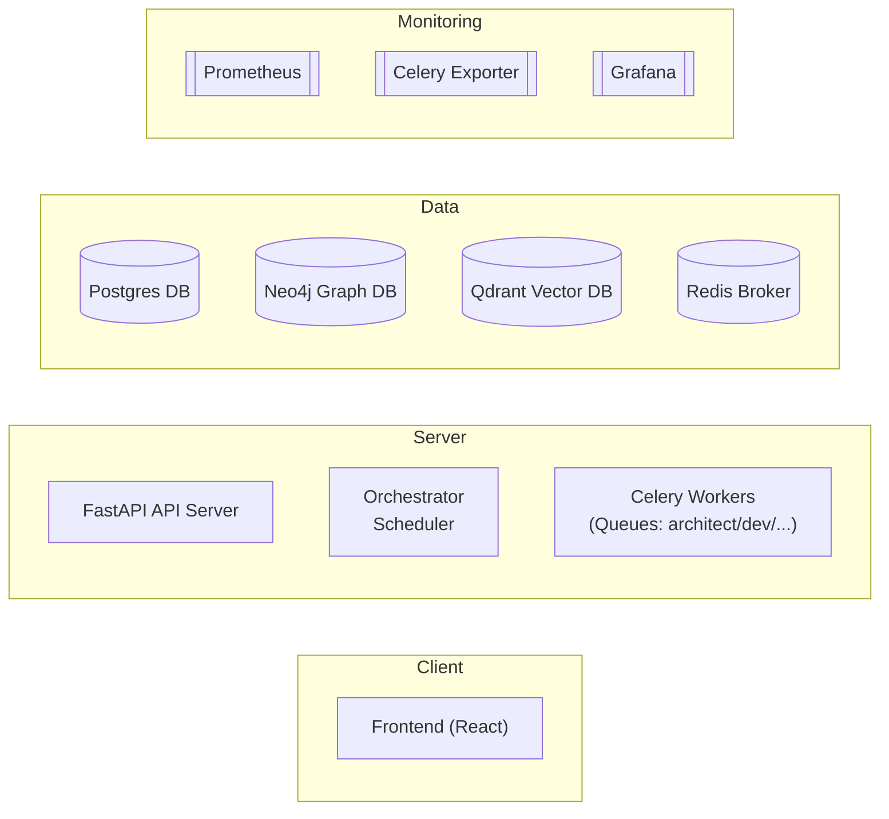

**Architecture & Services**

The AI Org Prototype follows a microservice-style architecture, with all components orchestrated via Docker Compose. Key components include:

- **FastAPI Backend (API Server)** – The core application server (runs with Uvicorn) providing REST endpoints (to create tasks, view backlogs, etc.) and orchestrating the AI agents. By default it listens on port 8000 inside the container (exposed to localhost) and connects to all databases, publishing new tasks to Celery.

- **Celery Workers** – Multiple asynchronous worker processes (Celery queues) that execute the “agent” tasks for different roles (e.g. architect, dev, qa, ux_ui, etc.). Workers pull tasks from Redis and call external APIs (like LLM services) as needed to fulfill their tasks.

- **Orchestrator (Scheduler)** – A specialized process for task scheduling and dependency management. It monitors the task graph (stored in Neo4j and the DB) and when prerequisites are met, it publishes new tasks to the Celery queues. In Docker this is the orchestrator service, which on startup also runs any pending database migrations.

- **PostgreSQL (Relational DB)** – Stores structured data such as tenants, tasks, artifacts, etc. using SQLModel (Python ORM). Runs in a container on port 5432 (default credentials: user postgres, password ai, database ai_org). The backend uses Postgres by default in Docker (for development you can fallback to SQLite outside of Docker).

- **Neo4j (Graph DB)** – Serves as the source-of-truth graph for task dependencies and artifact relationships. The orchestrator uses Neo4j to determine task execution order and maintain the project knowledge graph. Runs at bolt://localhost:7687 (with a browser UI at http://localhost:7474) with default credentials neo4j / s3cr3tP@ss.

- **Qdrant (Vector Store)** – A vector database for semantic embeddings, used as the “long-term memory” of the AI agents. The backend and agents store and query vector embeddings (for code, text, etc.) in Qdrant. Runs at http://localhost:6333 (REST API; no built-in UI, no auth by default).

- **Redis 7 (Broker & Cache)** – In-memory data store used as the Celery message broker and a cache. All Celery task queues are managed through Redis, which also holds runtime data like budget counters. Runs at redis://localhost:6379 (password ai_redis_pw) in the container network.

- **Prometheus & Grafana (Monitoring)** – Optional monitoring stack for metrics. The FastAPI backend exposes metrics at /metrics (port 8000) and a Celery Exporter provides task queue metrics on port 9808. Prometheus (port 9090) scrapes these metrics and Grafana (port 3000) provides dashboards to visualize them. (These services are included by default in the provided Docker Compose setups.)

- **Frontend UI (React)** – A single-page React 18 application (built with Vite + Tailwind) providing an admin dashboard to interact with the system. It allows creating new projects, viewing the task pipeline graph, monitoring budgets, and downloading artifacts. In development it runs on http://localhost:5173 via Vite dev server, or in production it’s served by an Nginx container on the same port. The frontend communicates with the FastAPI backend (ensure CORS is configured to allow the frontend origin in dev mode).

