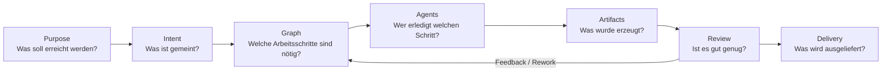

# AI-Org Prototype Vision

## Kurzfassung

AI-Org ist ein autonomes, graphgesteuertes Agenten-System, das aus einem menschlichen Ziel ein prüfbares Projekt macht: Anforderungen, Architektur, Arbeitsplan, Implementierungsartefakte, Reviews, Reports und Auslieferungspakete entstehen in einem kontrollierten Ablauf mit Budgetgrenzen, Traceability und menschlichen Freigabepunkten.

Das Produktversprechen ist nicht "ein Chatbot schreibt Code", sondern: **eine nachvollziehbare KI-Organisation plant und liefert Arbeitsergebnisse so, dass Menschen sie steuern, prüfen und freigeben können.**

## Problem

LLM-basierte Arbeit ist heute oft schnell, aber schwer kontrollierbar. Einzelne Prompts liefern punktuelle Ergebnisse, doch komplexe Projekte brauchen mehr:

- belastbare Zielklärung,
- explizite Abhängigkeiten,
- wiederholbare Workflows,
- Kosten- und Budgetkontrolle,
- nachvollziehbare Artefakt-Versionen,
- Review- und Freigabeprozesse,
- Monitoring für Laufzeit, Qualität und Fehler.

AI-Org adressiert diese Lücke, indem es KI-Arbeit nicht als Gespräch, sondern als **operatives System aus Rollen, Graphen, Queues, Artefakten und Reviews** modelliert.

## Mission

AI-Org soll Organisationen ermöglichen, wissensintensive Arbeit mit KI-Agenten auszuführen, ohne Kontrolle, Nachvollziehbarkeit und Verantwortlichkeit zu verlieren.

Das System übersetzt menschliche Absichten in strukturierte Workflows und macht jeden Schritt beobachtbar:

- Warum wurde eine Aufgabe erzeugt?
- Welcher Agent oder welche Capability ist verantwortlich?
- Welche Inputs und Artefakte wurden verwendet?
- Welche Kosten und Risiken sind entstanden?
- Welche Freigabe oder welches Feedback ist noch offen?

## Zielnutzer

| Nutzergruppe | Bedarf | AI-Org liefert |
| --- | --- | --- |
| Gründer und Produktverantwortliche | Aus Ideen belastbare Projektartefakte erzeugen | Purpose-, PRD-, Architektur- und Planungsflows |
| Engineering Leads | KI-Arbeit steuerbar in technische Prozesse einbetten | Graphen, Aufgaben, Reviews, Artefakt-Lineage |
| Consultants und Analysten | Wiederholbare Research- und Report-Workflows | Template-Familien, Quellenkontext, Reports |
| Solo-Builder | Schneller von Ziel zu lauffähigem Ergebnis kommen | Pipeline UI, Agentenrollen, ZIP-/Artefakt-Ausgabe |
| Betreiber | Kosten, Stabilität und Qualität überwachen | Budget-Gates, Metrics, Run-/Cost-Traces |

## Produktprinzipien

1. **Purpose vor Prompt**
   Jede Ausführung beginnt mit einem fachlichen Ziel, nicht mit einer isolierten Chat-Nachricht.

2. **Graph vor Magie**
   Komplexe Arbeit wird als expliziter Graph aus Knoten, Kanten, Bedingungen, Budgets und Freigaben modelliert.

3. **Artefakte vor Antworten**
   Wert entsteht durch persistierte, versionierte Ergebnisse: Dokumente, Code, Reports, Reviews, Konfigurationen und Archive.

4. **Menschliche Kontrolle bleibt Teil der Architektur**
   Kritische Schritte brauchen Approval Nodes, Review Gates oder manuelle Freigaben. Auto-Modus ist ein Betriebsmodus, kein Kontrollverlust.

5. **Kosten sind ein First-Class Constraint**
   Tokenbudgets, Budget-Gates und Cost-Traces sind nicht nachgelagert, sondern steuern Scheduling und Risiko.

6. **Traceability ist Produktqualität**
   Ergebnisse müssen erklärbar sein: von Purpose über Intent und Graph bis zu Task, Agent, Artefakt und Review.

7. **Templates schlagen Improvisation**
   Wiederholbare Arbeitsformen werden als deklarative Template-Familien gepflegt. Freie Synthese bleibt begrenzt und validiert.

## Produktpfeiler

### 1. Purpose Workspace

Ein Purpose ist der Arbeitskontext eines Projekts. Er bündelt Ziel, Modus, Pipeline, Tasks, Chat, Artefakte, Feedback und Status. Der Workspace soll die zentrale Oberfläche sein, in der Menschen die KI-Organisation steuern.

### 2. Intent Compiler

Freitext wird in strukturierte Absichten übersetzt: Domain, Aktion, Deliverable, Zielartefakte, Risiken, Constraints und Konfidenz. Unsichere oder riskante Absichten werden nicht blind ausgeführt, sondern in Review- oder Clarification-Flows überführt.

### 3. PipelineGraph

Der PipelineGraph beschreibt die Arbeit als ausführbaren Vertrag: Knoten, Kanten, Schemas, Retry-Policy, Timeouts, Human Approval, Revision Limits und Budgets. Legacy-Tasks bleiben ausführbar, aber neue Workflows orientieren sich am Graph-Vertrag.

### 4. Agentenorganisation

Agenten sind Rollen und Capabilities mit klarer Verantwortung: Product Owner, Architect, Planner, Developer, QA, UX/UI, Reviewer, Security, Performance, Integration, Research und weitere spezialisierte Worker.

### 5. Artifact System

Artefakte sind die eigentlichen Ergebnisse. Sie werden persistiert, versioniert, mit Feedback verknüpft und für Download, Review, Rework und Lineage genutzt.

### 6. Observability und Governance

Metriken, Run-Traces, Cost Records, Lineage Events, Audit Logs, Health Checks und Dashboards machen das System betreibbar. Ziel ist, KI-Arbeit wie einen Produktionsprozess zu beobachten.

## North-Star Outcomes

AI-Org ist erfolgreich, wenn es die folgenden Ergebnisse zuverlässig erzeugt:

- Ein Nutzer kann aus einem Purpose eine nachvollziehbare Pipeline starten.
- Das System erzeugt PRD, Architektur, Plan und Lieferartefakte mit Review-Status.
- Jede Aufgabe ist einem Tenant, Purpose, Agenten, Status und Budgetkontext zugeordnet.
- Artefakte sind versioniert, auffindbar, kommentierbar und exportierbar.
- Rework-Schleifen sind begrenzt, budgetiert und nachvollziehbar.
- Fehlerzustände bleiben sichtbar und wiederaufnehmbar statt still zu verschwinden.

## Qualitätsmaßstab

Ein Ergebnis gilt erst als gut, wenn es:

- fachlich zum Purpose passt,
- auf nachvollziehbaren Inputs basiert,
- im Graph korrekt eingeordnet ist,
- Kosten- und Risikogrenzen respektiert,
- als Artefakt gespeichert ist,
- Review- oder Freigabestatus besitzt,
- bei Änderungen downstream invalidiert oder aktualisiert werden kann.

## Betriebsmodi

| Modus | Bedeutung | Einsatz |
| --- | --- | --- |
| Manual | Das System pausiert an wichtigen Freigabepunkten. | Produkt-, Architektur- und Kundenarbeit |
| Auto | Das System läuft nach initialem Ziel möglichst selbständig weiter. | Demos, interne Workflows, risikoarme Aufgaben |
| Review/Rework | Bestehende Artefakte werden gezielt überarbeitet. | Qualitätsverbesserung, Feedbackzyklen |
| Research/Analysis | Quellen, Kontext und Synthesen stehen im Vordergrund. | Briefings, Reports, Wissensarbeit |

## Roadmap-Leitbild

### Jetzt

- Stabiler End-to-End-Prototyp für Purpose -> PRD -> Architektur -> Plan -> Tasks -> Artefakte.
- Mandantenfähigkeit, Auth, Budget-Gates, Monitoring und Docker-Compose-Betrieb.
- React Admin UI mit Pipeline-, Graph-, Reports-, Template- und Chat-Flows.
- Additive Architekturphasen für Intent, Graph Contracts, Templates, Rework, Observability und Test Harness.

### Als Nächstes

- Graph-v2 stärker als Runtime-Quelle etablieren.
- Intent Review und PipelineGraph-Auswahl in der UI enger zusammenführen.
- Artefakt-Lineage und Invalidation vollständig in Nutzerflows sichtbar machen.
- Replay-, Evaluation- und Cost-Dashboards produktnäher ausbauen.
- Template-Bibliothek mit mehr Domänen und besseren Acceptance-Kriterien erweitern.

### Später

- Mehrmandantenfähiger Betrieb mit klaren Isolation-, Billing- und Admin-Konzepten.
- Capability Marketplace für interne und externe Agentenfähigkeiten.
- Produktionsreife Governance: Rollen/Rechte, Audit, Policy Enforcement, Secrets, Compliance.
- Integrationen in GitHub, Dokumentensysteme, Kalender, Ticketsysteme und Deployment-Pipelines.

## Nicht-Ziele

AI-Org soll nicht:

- unkontrolliert beliebige Arbeit im Hintergrund ausführen,
- menschliche Verantwortung verschleiern,
- Ergebnisse ohne Artefakt-, Kosten- oder Review-Kontext als erledigt deklarieren,
- ein reiner Chat-Wrapper sein,
- eine monolithische "Alleskönner"-Agentenrolle aufbauen,
- unbegrenzte Rework- oder Suchschleifen erlauben.

## Design-Ton

Das Produkt soll sich wie ein operatives Kontrollzentrum für KI-Arbeit anfühlen: ruhig, präzise, nachvollziehbar, dicht genug für echte Arbeit und klar genug für schnelle Entscheidungen. Die UI dient nicht der Inszenierung der KI, sondern der Steuerung des Arbeitsprozesses.

## Leitentscheidung

AI-Org priorisiert **kontrollierte Autonomie**. Das System darf Arbeit selbständig ausführen, aber nur innerhalb expliziter Verträge: Purpose, Intent, Graph, Budget, Approval, Trace und Artefakt.
