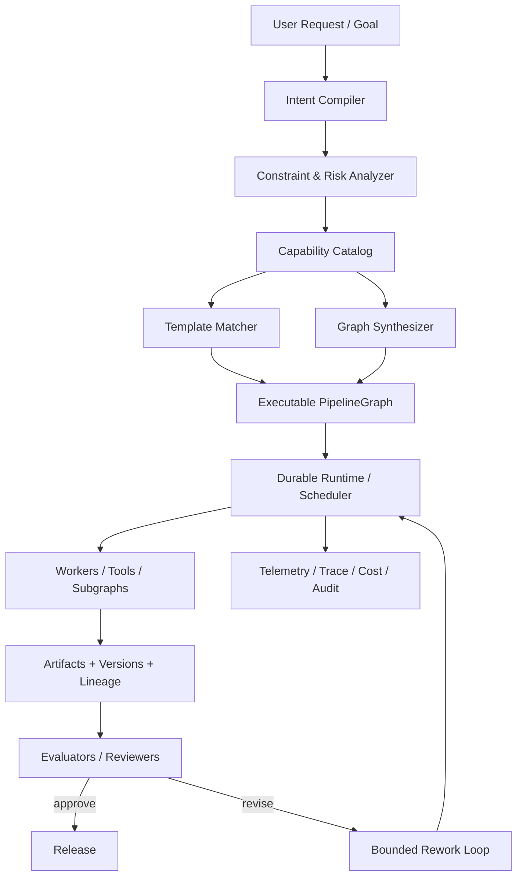
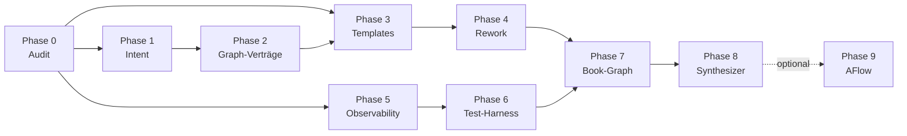
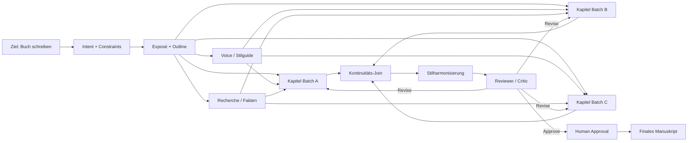

# Nachbesserungsplan `ai_org_prototype` — Operativer Auftrag an Codex

> **Adressat:** Codex (oder ein vergleichbarer Coding-Agent), der dieses Repo iterativ ausbaut.
> **Mandant:** Tim Mergenthaler.
> **Quelle der Wahrheit:** Deep-Research-Report vom Mai 2026 (graphbasierte Agentenarchitekturen).
> **Geltungsbereich:** Vollständige Evolution des Repos vom *template-gestützten Graph-Executor* zur *produktionsfähigen Goal-to-Graph-Plattform* — ohne Bruch der bestehenden Runtime.
> **Status:** verbindlich. Abweichungen nur mit dokumentierter Begründung im PR.

---

## 0. Mission in einem Satz

> **Halte die heutige Runtime stabil. Setze eine Semantikschicht (Intent → Graph) darüber. Standardisiere die Infrastruktur. Spezialisiere die Intelligenz. Erst Templates, dann Synthese, dann Suche.**

Alles, was diesem Satz widerspricht, ist im Zweifel falsch.

---

## 1. Leitprinzipien

Diese sieben Prinzipien überleben jede Refaktorisierung. Sie sind die Verfassung, nicht die Implementierung.

1. **Evolutionär, nicht revolutionär.** Bestehende Module für Persistenz, Heartbeat, DLQ, Locks, Approval, Feedback bleiben erhalten. Neue Schichten kommen *darüber*, nicht *anstelle*.
2. **Determinismus unten, Adaptivität oben.** Die Runtime ist deterministisch, replaybar, auditierbar. Adaptiv (LLM-basiert) ist nur die *Planung*: Intent-Erkennung und Graph-Auswahl/-Synthese.
3. **Mehrachsiger Intent statt Single-Label-Routing.** Es gibt keine `role: architect`-Klassifikation mehr. Intent ist immer `(domain, action, deliverable_type, target_artifact, scale, interaction_mode, risk, confidence)`.
4. **Standardisiere Infrastruktur, spezialisiere Intelligenz.** OpenTelemetry, OpenLineage, OpenAPI, MCP für Verträge und Telemetrie. Spezialcode nur für Domain-Planner, Evaluatoren, Rework-Policies.
5. **Bounded Loops.** Jede Rework-/Critic-Schleife hat `max_revisions`, ein Konvergenzkriterium *und* ein Kostenbudget. Niemals zwei davon, immer alle drei.
6. **Tech-Stack-flexibel.** Konkrete Komponenten (Postgres, Redis, Celery, Neo4j, Qdrant) sind heute gesetzt, aber jede Schnittstelle ist so zu gestalten, dass ein späterer Tausch (z. B. Celery → Temporal, Neo4j → Postgres-Adjazenz) ohne Knoten-/Template-Anpassung möglich ist.
7. **Observability ist Produktteil.** Ein Lauf, dessen Trace, Lineage und Kosten nicht in unter 30 Sekunden rekonstruierbar sind, ist nicht „fertig“.

---

## 2. Zielarchitektur (5 Schichten)



| Schicht | Verantwortung | Heutiger Zustand | Zielzustand |
|---|---|---|---|
| **L1 Intent** | NL → strukturierte Semantik | Single-Label-Router | Multi-Achsen-Compiler mit Ambiguitäts-Gate |
| **L2 Capability** | Inventar aller Rollen, Tools, Evaluatoren, Kosten | implizit in Code verstreut | deklarativer Katalog (YAML/JSON, versioniert) |
| **L3 Graph** | Auswahl/Synthese ausführbarer Graphen | Phasen-Templates pro Pipeline | typisierte Knoten/Kanten + Template-Bibliothek + bounded Synthesizer |
| **L4 Runtime** | durable Ausführung, Retry, Lock, Approval | Celery + Redis + Postgres, robust | unverändert, aber gegen abstrakte `WorkflowEngine`-Schnittstelle |
| **L5 Observability** | Trace, Lineage, Eval, Audit | Prometheus + Grafana | + OpenTelemetry + OpenLineage + Run-Trace + Eval-Dashboards |

---

## 3. Warum heute eine Lücke existiert

Aus dem Research-Report, ungekürzt zugespitzt:

> Das Repo ist bereits eine gute **Execution Plane**, aber nur eine begrenzte **Planning Plane**. Was fehlt, ist die saubere Semantikschicht über der Ausführung.

Der härteste Lackmustest dafür ist das Beispiel **„architect“ vs. „architecture rework“**: Ein Router, der nur „wer soll das tun?“ beantwortet, kollabiert auf eine Rolle. Ein Orchestrator muss zuerst „**was ist der Auftrag?**“ beantworten — und das ist mehrdimensional. Diese Trennung ist die Achse, um die sich alle nachfolgenden Phasen drehen.

---

## 4. Phasenplan (Übersicht)

Phasen werden **strikt** in dieser Reihenfolge gestartet. Parallelisierung nur wo unten explizit erlaubt.

| # | Phase | Zweck | Aufwand | Risiko | Parallel zu |
|---|---|---|---|---|---|
| 0 | Audit & Fundament | Status quo verifizieren, Tech-Schulden-Backlog | S | niedrig | — |
| 1 | Intent-Compiler | Multi-Achsen-Intent ersetzt Role-Routing | M | mittel | — |
| 2 | Knoten-/Kanten-Verträge | Typisierter `PipelineGraph` mit `Node`/`Edge`/`Edge-Type` | M | mittel | 1 |
| 3 | Template-Bibliothek | 4–6 kanonische Graph-Familien | M | mittel | — |
| 4 | Rework + Invalidierung | Bounded Loops, transitive Stale-Markierung | M | mittel | 3 |
| 5 | Observability-Stack | OTel + OpenLineage + Run-Trace + Cost-Dashboards | S–M | niedrig | 1, 2, 3 |
| 6 | 5-schichtiger Test-Harness | Unit/Contract, Graph-Validation, Replay, Eval, Chaos | M | mittel | 5 |
| 7 | Book-Writing-Graph | erste Nicht-Software-Domäne als Beweis | M | mittel | — |
| 8 | Bounded Graph-Synthesizer | dynamische Graphgenerierung mit Template-Fallback | H | hoch | — |
| 9 | (Optional) Workflow-Suche | AFlow-artige Optimierung, Forschungsausbau | XH | sehr hoch | — |



**Definition of Done pro Phase:** alle Akzeptanzkriterien grün, Tests grün, Trace+Lineage für mindestens einen End-to-End-Lauf vorhanden, PR mit ADR (Architecture Decision Record) gemerged, Doku in `docs/architecture/` aktualisiert.

---

## Phase 0 — Audit & Fundament

### Ziel
Bestandsaufnahme verifizieren und Tech-Schulden, die alle nachfolgenden Phasen blockieren würden, abräumen.

### Begründung
Der Research-Report stützt sich auf eine Codebase-Analyse vom Stand vor dem Plan. Bevor Codex semantische Schichten draufsetzt, muss er den realen Zustand selbst prüfen, nicht den dokumentierten.

### Deliverables
- `docs/architecture/00-audit-report.md`: Inventar aller Module mit Verantwortung in 1 Zeile, deklariert per `grep`/`tree`-Analyse, nicht aus README.
- `docs/architecture/00-debt-backlog.md`: priorisierte Liste von Tech-Schulden (max. 25 Einträge), klassifiziert als `blocking | important | nice-to-have`.
- `docs/architecture/00-glossary.md`: einheitliche Begriffsdefinitionen für `Task`, `Pipeline`, `Phase`, `Purpose`, `Artifact`, `Run`, `Node`, `Edge`. Solange diese acht Begriffe unscharf sind, kann Phase 1 nicht starten.
- `Makefile`-Target `make audit` erzeugt diese Reports reproduzierbar.

### Akzeptanzkriterien
- Audit-Report listet alle FastAPI-Routen, Celery-Tasks, Repos und Services mit jeweils einem Satz Verantwortung.
- Glossar enthält für jeden Begriff: Definition, Datenstruktur-Referenz, Lebenszyklus, abgrenzende Negativbeispiele.
- Mindestens drei `blocking`-Schulden sind im selben Sprint adressiert (Fix oder dokumentierte Akzeptanz).

### Out of Scope
Keine neuen Features, keine Schemata, keine Prompts. Reine Inventur.

---

## Phase 1 — Intent-Compiler

### Ziel
Eingehende Nutzeraufträge werden in eine strukturierte Mehrachsen-Repräsentation übersetzt. Single-Label-Routing existiert nicht mehr.

### Begründung
Aus dem Report:
> Für offene Ziele wie „schreib mir ein Buch“ reicht ein Single-Label-Router nach dem Muster „welcher Agent/Role-Queue?“ nicht aus.

### Datenmodell (verbindlich)

```python
# backend/ai_org_backend/intent/schema.py
from typing import Literal, Optional, Any
from pydantic import BaseModel, Field

class UserIntent(BaseModel):
    domain: Literal["software", "book", "research", "ops", "general"]
    action: Literal["create", "rework", "review", "continue", "summarize", "translate"]
    deliverable_type: str                       # frei, aber katalogisiert
    target_artifact_id: Optional[str] = None
    target_artifact_type: Optional[str] = None
    scale: Literal["small", "medium", "large"] = "medium"
    interaction_mode: Literal["auto", "manual", "hybrid"] = "hybrid"
    risk: Literal["low", "medium", "high"] = "medium"
    constraints: dict[str, Any] = Field(default_factory=dict)
    confidence: float = Field(ge=0.0, le=1.0)
    rationale: str                              # Begründung der Klassifikation
    raw_request: str                            # Original-Prompt, unverändert
```

### Architektur des Compilers (Kaskade)

1. **Signal-Extraktion**: regelbasiert (Keywords, Artefakt-Referenzen, Verben). Schnell, billig, deterministisch.
2. **Kontext-Auflösung**: existiert ein referenziertes Artefakt? Liegt eine letzte Version vor? Repo-Lookup.
3. **Strukturierte LLM-Klassifikation**: nur wenn (1)+(2) nicht ausreichen. Liefert `UserIntent` als JSON.
4. **Konsistenzprüfung**: deterministische Regeln (`action=rework` ⇒ `target_artifact_id` muss existieren; `domain=book` ⇏ `deliverable_type=architecture_blueprint`).
5. **Confidence-Gate**: bei `confidence < 0.75` oder Inkonsistenz ⇒ `clarification_node` einfügen oder Human-Approval anfordern.

### Deliverables
- `backend/ai_org_backend/intent/` mit `schema.py`, `extractor.py`, `resolver.py`, `classifier.py`, `validator.py`, `compiler.py`.
- `backend/tests/intent/`: ≥ 30 Goldene-Testfälle, davon mindestens 5 Adversarial (mehrdeutig, falsche Artefaktreferenz, Domain-Mismatch).
- Alte Router-Logik wird **adapter-basiert** weiterbetrieben: `compiler.py` kann eine `UserIntent` in eine bestehende Role-Queue mappen, bis Phase 2 abgeschlossen ist.

### Akzeptanzkriterien
- Zwei Eingaben „bitte als Architekt das System X überarbeiten“ und „bitte ein neues System X entwerfen“ erzeugen unterschiedliche `UserIntent`-Ausgaben mit jeweils korrektem `action` und `target_artifact_*`.
- Confidence-Gate erzeugt für 100 % der Adversarial-Fälle einen Clarification- oder Approval-Pfad.
- Latenz P95 < 1.5 s ohne LLM-Aufruf, < 4 s mit LLM-Aufruf.
- Trace pro Aufruf in OTel sichtbar (Phase 5 dependency: ja, aber Stub-Span reicht hier).

### Out of Scope
Graph-Auswahl, Synthese, Template-Matching. Der Compiler liefert nur die Intent-Struktur.

### Risiko & Gegenmaßnahme
Falsche Klassifikationen wirken still und spät. Pflicht: jede `UserIntent` wird vor Ausführung im UI sichtbar gemacht; Tim oder ein Reviewer kann sie korrigieren, bevor der Graph startet (Phase 1 liefert dafür ein Read-/Edit-Endpoint).

---

## Phase 2 — Knoten- & Kanten-Verträge (`PipelineGraph` v2)

### Ziel
Pipelines sind nicht mehr Listen von Phasen, sondern explizit typisierte Graphen mit Knoten, Kanten, Bedingungen, Aktivierungssemantik, Retry-/Timeout-Policies und Versionierung.

### Begründung
Report:
> Diese Primitive finden sich – in unterschiedlichen Ausprägungen – in LangGraph, Haystack und GraphFlow wieder.

Heute existieren Phasen mit `order`/`predecessor`. Das ist ein impliziter Graph. Phase 2 macht ihn explizit.

### Datenmodell (verbindlich, Tech-neutral)

```python
# backend/ai_org_backend/graph/schema.py
from typing import Literal, Optional, Any
from pydantic import BaseModel, Field
from .intent.schema import UserIntent

NodeKind = Literal[
    "planner", "generator", "tool", "reviewer", "evaluator",
    "approval", "join", "router", "repair", "publish", "clarification"
]
EdgeType = Literal["control", "data", "feedback", "invalidates"]

class PipelineNode(BaseModel):
    id: str
    kind: NodeKind
    capability: str                         # Referenz in Capability Catalog
    input_schema: dict[str, Any] = Field(default_factory=dict)
    output_schema: dict[str, Any] = Field(default_factory=dict)
    retry_policy: dict[str, Any] = Field(default_factory=dict)
    timeout_s: int = 300
    max_revisions: int = 0
    requires_human_approval: bool = False
    cost_budget: Optional[dict[str, Any]] = None
    metadata: dict[str, Any] = Field(default_factory=dict)

class PipelineEdge(BaseModel):
    source: str
    target: str
    condition: Optional[str] = None         # DSL/Predicate-Name
    activation: Literal["all", "any"] = "all"
    edge_type: EdgeType = "control"

class PipelineGraph(BaseModel):
    id: str
    template_family: Optional[str] = None
    intent: UserIntent
    nodes: list[PipelineNode]
    edges: list[PipelineEdge]
    version: int = 1
    checksum: str                           # deterministischer Hash über (nodes, edges)
```

### Migration der Bestandsphasen
- Bestehende Phasen-Definitionen werden via Adapter in `PipelineGraph` v2 abgebildet (`graph/adapters/legacy_phases.py`).
- Bestehende Tasks bleiben unverändert; neue Tasks tragen zusätzlich `node_id` und `graph_id`.
- Doppelte Schreibung (Legacy + neu) für eine Sprintphase, dann Schalter `FEATURE_GRAPH_V2=true` final umlegen.

### Engine-Abstraktion (Tech-Stack-Flexibilität)
```python
# backend/ai_org_backend/graph/engine.py
from typing import Protocol

class WorkflowEngine(Protocol):
    def submit(self, graph: PipelineGraph, payload: dict) -> str: ...
    def status(self, run_id: str) -> "RunStatus": ...
    def cancel(self, run_id: str) -> None: ...
    def replay(self, run_id: str, from_node: str | None = None) -> str: ...

class CeleryEngine: ...      # heute
# class TemporalEngine: ...  # später, ohne Eingriff in Templates/Knoten
```

### Deliverables
- `backend/ai_org_backend/graph/` (`schema.py`, `engine.py`, `validator.py`, `adapters/legacy_phases.py`).
- Alembic-Migration: neue Tabellen `pipeline_graphs`, `pipeline_nodes`, `pipeline_edges`, `runs`. Bestehende Tabellen bleiben.
- `make graph-validate` validiert jeden Graph vor Submission.

### Akzeptanzkriterien
- Bestandspipelines lassen sich verlustfrei in `PipelineGraph` v2 serialisieren und zurückladen (Roundtrip-Test, ≥ 5 Pipelines).
- `validator.py` lehnt Graphen mit (a) unbeschränkten Zyklen, (b) toten Knoten, (c) typinkompatiblen Kanten, (d) High-Risk-Knoten ohne Approval, (e) nicht auflösbaren Artefaktreferenzen ab.
- `WorkflowEngine`-Adapter `CeleryEngine` führt mindestens eine bestehende Pipeline ohne Verhaltensänderung aus.

### Out of Scope
Templates (Phase 3), Synthesizer (Phase 8). Hier nur Verträge und Validator.

---

## Phase 3 — Template-Bibliothek (4–6 kanonische Graph-Familien)

### Ziel
Für die wichtigsten Domänen existiert je ein versionierter, deklarativer Graph-Blueprint, den der Compiler instantiieren kann.

### Pflicht-Familien
1. `software_delivery` — Vision → PRD → Architektur → Architektur-Review → Implementierungsplan → Implementation → QA → Release
2. `book_writing` — Ziel/Lesergruppe → Exposé → Outline → Stilguide → (Recherche ∥ Kapitel-Fan-out) → Kontinuitäts-Join → Stilharmonisierung → Review → Approval → Release
3. `research_brief` — Frage → Quellenstrategie → Quellen-Fan-out → Synthese → Bias-Check → Reviewer → Brief
4. `analysis_report` — Frage → Datenscope → Datenextraktion → Analyse → Cross-Check → Bericht
5. `knowledge_base_update` — Quelle → Diff → Konsolidierung → Reviewer → Publish
6. *(optional)* `architecture_rework` — explizit als eigene Familie, weil semantisch verschieden von `software_delivery.create`

### Deliverables
- `backend/ai_org_backend/graph/templates/<family>.yaml` je Familie. YAML, weil Codex (und Tim) sie ohne Python lesen sollen.
- `backend/ai_org_backend/graph/template_matcher.py`: deterministisches Matching via `(domain, action, deliverable_type)` plus Confidence-Score.
- `docs/architecture/03-templates.md`: jedes Template mit Diagramm (Mermaid), Input/Output-Schemata, Kosten-/Zeitbudget, bekannten Failure Modes.

### Template-Schema (YAML)
```yaml
# graph/templates/book_writing.yaml
id: book_writing.v1
matches:
  domain: book
  action: create
  deliverable_type: manuscript
nodes:
  - id: outline
    kind: planner
    capability: book.outline_planner
    input_schema: {ref: schemas/book/goal.json}
    output_schema: {ref: schemas/book/outline.json}
    retry_policy: {max_attempts: 3, backoff: exponential}
    timeout_s: 600
  - id: chapters
    kind: generator
    capability: book.chapter_writer
    fan_out:
      from: outline.chapters
      max_parallel: 5
  - id: continuity
    kind: evaluator
    capability: book.continuity_check
  - id: style_pass
    kind: repair
    capability: book.style_harmonizer
    max_revisions: 2
  - id: review
    kind: reviewer
    capability: book.editorial_review
    requires_human_approval: true
edges:
  - {source: outline, target: chapters, edge_type: control}
  - {source: chapters, target: continuity, activation: all}
  - {source: continuity, target: style_pass, condition: "score < 0.8"}
  - {source: style_pass, target: continuity, edge_type: feedback}
  - {source: continuity, target: review, condition: "score >= 0.8"}
budgets:
  cost_eur: 25.0
  wallclock_h: 12
```

### Akzeptanzkriterien
- Jede Familie ist mit einem End-to-End-Smoke-Test belegt (klein, billig, aber vollständig durchlaufend).
- `template_matcher` wählt für jede der 6 Familien bei passendem `UserIntent` mit ≥ 0.9 Confidence das richtige Template (Test-Korpus 60 Fälle).
- Keine Familie hat unbeschränkte Loops; jede hat Approval-Gate für High-Risk-Knoten.

### Out of Scope
Synthesizer für nicht-passende Intents (Phase 8).

---

## Phase 4 — Bounded Rework & Invalidierung

### Ziel
Rework ist kein Sonderfall, sondern ein erstklassiges Graph-Muster mit klar definierter Semantik, Begrenzung und Invalidierungslogik.

### Verbindliche Regel
> Wird ein Upstream-Artefakt substanziell geändert, werden alle transitiv abhängigen Artefakte in den Status `stale` versetzt; deren Knoten wechseln auf `todo`; die Rework-Schleife startet am niedrigsten nötigen Recompute-Punkt, nicht am Pipeline-Anfang.

Diese Regel ist normativ. Jede Implementierung, die früher startet, ist falsch.

### Deliverables
- `backend/ai_org_backend/services/rework.py`: zentraler Service. Bestehender Feedback-Loop-Service wird hier konsolidiert, nicht parallel weitergeführt.
- `RevisionLimitPolicy` (Pydantic): `max_revisions`, `convergence_predicate`, `cost_budget`. **Alle drei müssen gesetzt sein**, sonst Validierungsfehler.
- `ArtifactGraph`-Service: pflegt Abhängigkeiten zwischen Artefaktversionen (`derived_from`, `invalidates`).
- Migration auf `artifacts.status` mit Werten `fresh | stale | invalidated | archived`.

### Akzeptanzkriterien
- Test: Änderung an `architecture_blueprint v3` markiert `implementation_plan v2` als `stale` und triggert ausschließlich die abhängigen Knoten neu.
- Test: Schleife `critic → revise → re-evaluate` bricht spätestens bei `max_revisions=3` ab und schreibt `terminal_status=revision_limit_reached`.
- Test: Konvergenzprädikat (`score >= 0.85`) beendet die Schleife früher, ohne weiteres Revise.
- Kostenbudget-Überschreitung erzeugt `terminal_status=budget_exceeded` und einen Approval-Knoten für Tim, der manuell verlängern kann.

### Out of Scope
Domain-spezifische Konvergenzkriterien — die liegen im jeweiligen Template (Phase 3) bzw. Evaluator (Phase 7).

---

## Phase 5 — Observability-Stack (OTel + Lineage + Run-Trace + Cost)

### Ziel
Jeder Lauf, jeder Knoten, jeder Tool-Call, jedes Artefakt ist in zwei Sichten korreliert wiederfindbar: **System-Trace** (OTel) und **Agent-Trace** (LangSmith oder gleichwertig). Lineage über OpenLineage.

### Deliverables
- OTel-Instrumentierung in FastAPI, Celery, allen Services. Span-Hierarchie: `request → graph → node → tool_call → llm_call`.
- OpenLineage-Emitter: Jeder Knoten emittiert `START`/`COMPLETE` mit `inputs`/`outputs` als Datasets (Artefakt-IDs).
- LangSmith-Integration (oder Phoenix/Arize/eigener Run-Store, austauschbar hinter `RunTracer`-Protocol). Pflicht: jeder Prompt, jede Tool-Decision, jede Score sind sichtbar.
- Grafana-Dashboards (Phase 5):
  - **Run Health**: Erfolgsquote pro Knotentyp, Retry-Quote, DLQ-Rate.
  - **Graph Shape**: durchschnittlicher Branching-Faktor, Anzahl Rework-Runden, Drift Plan vs. Run.
  - **Cost & Time**: Kosten pro freigegebenem Artefakt, Approval-Dwell-Time, Token-Budget-Auslastung.
  - **Lineage**: Anteil invalidierter Downstream-Artefakte pro Upstream-Änderung.

### Akzeptanzkriterien
- Für einen Beispiellauf des `book_writing`-Templates kann Tim binnen 30 Sekunden in Grafana finden: (a) welcher Knoten warum revised hat, (b) welches Artefakt davon abhängig invalidiert wurde, (c) Kosten und Dauer pro Knoten.
- PII-Filter in Trace-Export ist aktiv (kein Klartext aus User-Prompts in Trace-Tags ohne Allowlist).
- Trace-Volumen ist bounded: Sampling-Strategie dokumentiert, P99 Trace-Größe pro Lauf < 5 MB.

### Out of Scope
Eval-Dashboards für Domain-Qualität (Stiltreue, Plot-Konsistenz) — Phase 6+7.

---

## Phase 6 — 5-schichtiger Test-Harness

### Ziel
Tests sind nicht Status-Assertions auf Tasks, sondern Korrektheits-Garanten auf fünf Ebenen. Ohne diese Ebenen ist Phase 7 (Book) nicht startbar.

### Schichten

| # | Schicht | Was wird getestet | Werkzeug |
|---|---|---|---|
| 1 | **Unit / Contract** | jede `PipelineNode`-Capability gegen ihr Input/Output-Schema | pytest, jsonschema |
| 2 | **Graph-Validation** | keine Zyklen ohne Rework-Marker, keine toten Knoten, alle High-Risk haben Approval | `validator.py` aus Phase 2 |
| 3 | **Replay** | aus Checkpoint reproduzierbare Wiederaufnahme, idempotent | Run-Store-Snapshots |
| 4 | **Evaluator / Golden Set** | Domain-Qualität (Stiltreue, Architekturvollständigkeit, Kapitelkontinuität) | golden corpora + Rubrik-Scorer |
| 5 | **Chaos / Failure Injection** | Timeouts, Provider-Ausfall, kaputte Tool-Responses, doppelte Events, verlorene Heartbeats | `chaos.py`-Harness, Toxiproxy-Optional |

### Deliverables
- `backend/tests/contracts/`, `backend/tests/graph/`, `backend/tests/replay/`, `backend/tests/eval/`, `backend/tests/chaos/`.
- `make test-all` führt alle 5 Schichten aus; CI hat eigene Stages.
- Mindestens **80 % Coverage** für `graph/`, `intent/`, `services/rework.py`. Branchcoverage, nicht nur Linecoverage.

### Akzeptanzkriterien
- Jede Phase 1–5 ist mit eigenen Tests in mindestens drei der fünf Schichten belegt.
- Chaos-Test `provider_outage` lässt einen Lauf nach Wiederkehr aus Checkpoint resumen, Ergebnis bit-identisch (modulo Zeitstempel).
- Eval-Schicht hat für `software_delivery` und `book_writing` je ein Golden-Set mit ≥ 5 Beispielen und Rubrik.

### Out of Scope
Performance-Lasttests (separate Phase, falls je nötig).

---

## Phase 7 — Book-Writing-Graph (Premiere)

### Ziel
Der erste komplexe nicht-Software-Workflow läuft End-to-End. Kein Forschungs-Showcase, sondern Beweis: die Architektur trägt offene Wissensarbeit.

### Begründung
Report:
> Ein Buch ist kein einzelner Knoten und meist auch keine lineare Pipeline. […] hierarchischer Arbeitsgraph mit Fan-out/Fan-in und bounded revision loops.



### Deliverables
- `book_writing.yaml`-Template aus Phase 3 in produktionsfähigem Zustand.
- Domain-Capabilities in `backend/ai_org_backend/agents/book/`:
  - `outline_planner`, `chapter_writer`, `continuity_check`, `style_harmonizer`, `editorial_review`.
- Domain-Evaluatoren mit Rubriken: Kontinuität, Stiltreue, Plot/Argumentationslinie, Redundanz, Figurenkonsistenz, Zielgruppenfit.
- UI-Erweiterung: Kapitel-Fortschritt sichtbar, Reviewer-Kommentare adressierbar, Approval-Gate für Tim.

### Akzeptanzkriterien
- End-to-End-Lauf mit einem 8-Kapitel-Sachbuch-Outline produziert ein konsistentes Manuskript. Kosten und Zeit innerhalb der Template-Budgets.
- `continuity_check` markiert mindestens einen Inkonsistenz-Fall im adversarialen Test korrekt.
- Tim kann an drei definierten Stellen (Outline, Stilguide, Final) eingreifen, ohne dass der Graph abbricht.
- Lineage zeigt für jedes Kapitel die exakten Eltern-Artefakte (Outline-Version, Stilguide-Version, Recherche-Version).

### Out of Scope
Belletristik mit komplexen Figuren-Arcs — explizit später. MVP ist Sachbuch oder strukturierter Long-Form-Inhalt.

---

## Phase 8 — Bounded Graph-Synthesizer

### Ziel
Wenn kein Template mit ausreichender Confidence matcht, kompiliert der Synthesizer aus dem Capability-Katalog einen ausführbaren Graphen — innerhalb harter Begrenzungen.

### Algorithmus (verbindlich)

```python
def compile_graph(request, context, catalog) -> PipelineGraph:
    intent = classify_intent(request, context)               # Phase 1

    candidates = match_templates(intent, catalog)            # Phase 3
    if candidates and intent.confidence >= 0.75:
        graph = instantiate_best_template(intent, candidates, catalog)
    else:
        graph = synthesize_graph_from_capabilities(intent, catalog)

    graph = insert_safety_and_quality_gates(graph, intent)   # Phase 4
    graph = validate_graph(graph)                            # Phase 2
    return graph
```

### Harte Grenzen für `synthesize_graph_from_capabilities`
- maximal **20 Knoten**
- maximal **3 Schleifen**, jede gebounded
- jeder High-Risk-Knoten erhält automatisch Approval-Gate
- Kosten-Vorabschätzung muss innerhalb `intent.constraints.budget` liegen, sonst Abbruch mit Vorschlag zur Aufgabenverkleinerung
- Synthesizer darf nur Capabilities aus dem deklarierten Katalog verwenden, niemals erfinden

### Deliverables
- `backend/ai_org_backend/graph/synthesizer.py`
- `backend/ai_org_backend/graph/capability_catalog/` als versioniertes Verzeichnis (YAML pro Capability)
- Trace-Annotation `graph.origin = template | synthesized`, damit Drift sichtbar bleibt

### Akzeptanzkriterien
- Für 20 manuell konstruierte Adversarial-Intents (kein passendes Template) erzeugt der Synthesizer entweder einen valide ausführbaren Graphen oder lehnt mit klarer Begründung ab. Kein Crash, keine Halluzination einer nicht existenten Capability.
- Synthesizer übersteigt nie die harten Grenzen — Property-Test mit zufälligen Intents.
- Drift-Metrik (Plan vs. Run) ist in Phase-5-Dashboards sichtbar.

### Out of Scope
Such-/Optimierungsverfahren (Phase 9). Hier nur deterministische Komposition aus dem Katalog.

---

## Phase 9 — (Optional) Workflow-Suche im Stil von AFlow

### Ziel
Wenn — und nur wenn — Phasen 1–8 stabil produktiv laufen: Workflow-Optimierung als Suche über code-/graph-repräsentierte Workflows mit MCTS oder vergleichbarem Verfahren.

### Vorbedingungen (alle müssen erfüllt sein)
- Mindestens 3 Domänen mit ≥ 50 echten Läufen pro Domäne und Eval-Scores.
- Kostenbudgets pro Suche sind hart, vom CFO (Tim) explizit freigegeben.
- Kill-Switch: jede Such-Iteration ist abbrechbar, jede gefundene Variante ist auditierbar.

### Begründung
Report:
> AFlow ist forschungsnah und hochinteressant, aber für die meisten Teams zu Beginn überdimensioniert.

### Akzeptanzkriterien
Wird erst beim Start dieser Phase definiert. **Phase 9 darf nicht spekulativ vorbereitet werden.** Code-Stubs, leere Module, Architekturskizzen sind hier explizit untersagt, solange Phase 8 nicht produktiv ist.

---

## 5. Cross-Cutting Concerns

### 5.1 Standards (verbindlich)
- **OpenAPI** für jede HTTP-Schnittstelle (auch interne Services).
- **MCP** für jedes Tool, das ein Agent aufruft. Wo ein bestehendes Tool kein MCP spricht, wird ein dünner MCP-Adapter geschrieben, kein Bypass.
- **OpenTelemetry** für jedes System-Telemetrie-Event.
- **OpenLineage** für jeden Artefakt-Erzeuger/-Konsumenten.
- **JSON Schema** für jedes Knoten-Input/Output.

### 5.2 Versionierung
- Templates: SemVer pro Familie (`book_writing.v1.3.0`). Major-Bump = Brechung.
- Capabilities: SemVer.
- Artefakte: monoton steigende Version pro `target_artifact_id`. Lineage zeigt `derived_from`.
- Migration jeder neuen Schemaversion via Alembic, kein Schema-Drift in Produktion.

### 5.3 Sicherheit & Governance
- Keine Secrets in Prompts, keine Secrets in Trace-Tags, keine Secrets in Lineage-Metadaten. Pflicht-Filter im OTel-Exporter und im LLM-Wrapper.
- Pro High-Risk-Knoten: Approval-Knoten + Audit-Eintrag.
- BSI-konforme Mindestpunkte: nachvollziehbarer Betrieb (Phase 5), robustes Verhalten (Phase 6 Chaos), sichere Modellaufrufe (Allowlist Provider, kein freier Egress).
- DSGVO: Prompts und Artefakte sind löschbar. Kein „permanent löschen“ ohne explizite Tim-Bestätigung im UI.

### 5.4 Tech-Stack-Flexibilität
| Heute | Schnittstellen-Abstraktion | Möglicher Tausch später |
|---|---|---|
| Celery + Redis | `WorkflowEngine`-Protocol (Phase 2) | Temporal, Restate, eigene durable runtime |
| Postgres-Adjazenz + Neo4j | `GraphStore`-Protocol | reines Postgres oder reines Neo4j |
| Qdrant | `VectorStore`-Protocol | pgvector, Weaviate, Vespa |
| Prometheus + Grafana + LangSmith | OTel + OpenLineage als Lingua franca | Tempo, Honeycomb, Phoenix, Arize |
| OpenAI / Anthropic / xAI | `LLMProvider`-Protocol | jeder Provider mit MCP- oder OpenAI-kompatibler API |

Codex darf eine konkrete Implementierung wählen, **muss** aber das Protocol einführen, sodass der Tausch ohne Knoten-/Template-Änderung möglich bleibt.

---

## 6. Anti-Patterns (Was Codex nicht tun darf)

1. **Single-Label-Routing wieder einführen.** Auch nicht „nur als Fallback“. Auch nicht „nur intern“.
2. **Unbounded Loops.** Kein `while not converged: revise()` ohne `max_revisions`, Konvergenzprädikat **und** Kostenbudget.
3. **Phase 9 vorzeitig beginnen.** Keine MCTS-/Suchstubs, solange Phase 8 nicht produktiv.
4. **Neuer Datenstore „weil es passt“.** Jeder neue Store braucht ADR, Migrationspfad und Rückbau-Plan.
5. **Prompt-Engineering als Architektur-Workaround.** Wenn ein Knoten falsch reagiert, ist die Antwort fast nie „besserer Prompt“. Antwort ist: Schema, Validator, Evaluator oder Approval-Gate.
6. **Trace-Volumen ungebounded.** Keine ungesampelten LLM-Vollausgaben in OTel-Tags.
7. **Synchroner Aufruf, der eigentlich asynchron sein müsste.** Buchschreiben ist asynchron. UI zeigt Progress, nicht Spinner.
8. **README-getriebene Architektur.** Doku folgt Code, nicht andersherum. ADRs sind Pflicht für jede Phase.
9. **„Quick Fix“ am Feedback-Loop.** Phase 4 konsolidiert ihn vollständig, danach gibt es nur einen.
10. **Capabilities erfinden.** Synthesizer (Phase 8) darf ausschließlich aus dem deklarierten Katalog komponieren.

---

## 7. System-weite Definition of Done

Ein Stand des Repos ist „done“, wenn alles davon zutrifft:

- Alle bisherigen Phasen-Akzeptanzkriterien sind grün, dokumentiert in `docs/architecture/`.
- `make test-all` ist grün, inkl. Chaos-Schicht.
- Für drei Domänen (`software_delivery`, `book_writing`, eine weitere) existiert je ein End-to-End-Beispiel mit vollständigem Trace, Lineage und Eval-Score.
- Tim kann in unter 30 Sekunden in Grafana finden, warum ein Lauf in Status X gelandet ist.
- Ein neuer Domain-Workflow lässt sich über ein neues YAML-Template plus 1–3 neue Capabilities einführen, ohne Code in `intent/`, `graph/engine.py` oder `services/rework.py` zu ändern.
- Tech-Stack-Tausch (z. B. Engine `Celery` → `Temporal`) ist auf Protocol-Ebene möglich, mit ADR + Migration.

---

## 8. Glossar (Kurzform — Vollform in `docs/architecture/00-glossary.md`)

- **Intent** — strukturierte Repräsentation eines Nutzerauftrags. Mehrachsig. Pflichtfeld jedes Graphlaufs.
- **Capability** — atomare, wiederverwendbare Fähigkeit eines Agenten/Tools. Im Capability-Katalog deklariert, versioniert.
- **Node** — Knoten im Graphen. Trägt eine Capability, ein Schema und Policies.
- **Edge** — gerichtete Kante. Typ `control | data | feedback | invalidates`.
- **PipelineGraph** — vollständiger ausführbarer Graph für genau einen Lauf. Hat einen Checksum.
- **Run** — eine konkrete Ausführung eines `PipelineGraph` mit Input, Status, Trace, Lineage.
- **Artifact** — typisiertes, versioniertes Output. Hat `derived_from`-Lineage, `status`, `version`.
- **Rework** — wiederholte Bearbeitung eines bestehenden Artefakts mit `revise → re-evaluate`-Schleife. Bounded.
- **Template Family** — Satz kanonischer Graphen für eine Domäne (z. B. `book_writing`). Versioniert.
- **Synthesizer** — Komponente, die fehlende Templates durch deterministische Komposition aus Capabilities ersetzt. Bounded.

---

## 9. Quellen & Bezug zur Forschung

Dieser Plan operationalisiert den Deep-Research-Report (Mai 2026). Die Architekturentscheidungen stützen sich konsistent auf:

- LangGraph, Haystack, AutoGen GraphFlow, Airflow, Temporal — als Referenzen für durable, graphbasierte Orchestrierung.
- ReAct, Graph of Thoughts, Self-Refine, MetaGPT, AFlow — als Forschungsrahmen für Reasoning, iterative Verbesserung und Workflow-Optimierung.
- BSI / Fraunhofer IPA — für Sicherheits-, Robustheits- und Nachvollziehbarkeitsanforderungen im deutschsprachigen Produktionskontext.

Vollständige Belege im Research-Report. Codex zitiert in PRs und ADRs den jeweiligen Abschnitt des Reports, wenn er eine Architekturentscheidung auf ihn stützt.

---

## 10. Übergabeprotokoll an Codex

1. Codex liest diesen Plan in voller Länge, bevor er die erste Zeile Code schreibt.
2. Codex startet **niemals** eine Phase, deren Vorgänger nicht „done“ ist.
3. Pro Phase: ein eigener Branch `feat/phase-<n>-<slug>`, ein PR, ein ADR (`docs/architecture/adr-<nnnn>-<slug>.md`).
4. Pro PR: Verweis auf die zutreffenden Akzeptanzkriterien dieses Plans, Testnachweis, Trace-Screenshot.
5. Im Zweifelsfall: Phasenvorgaben schlagen Bauchgefühl. Wenn sie falsch sind, schlägt Codex einen Plan-Patch vor, statt eigenmächtig abzuweichen.

---

*Ende des Nachbesserungsplans. Keine Kompromisse, kein Wunschdenken, keine Phase 9 ohne Phase 8.*
